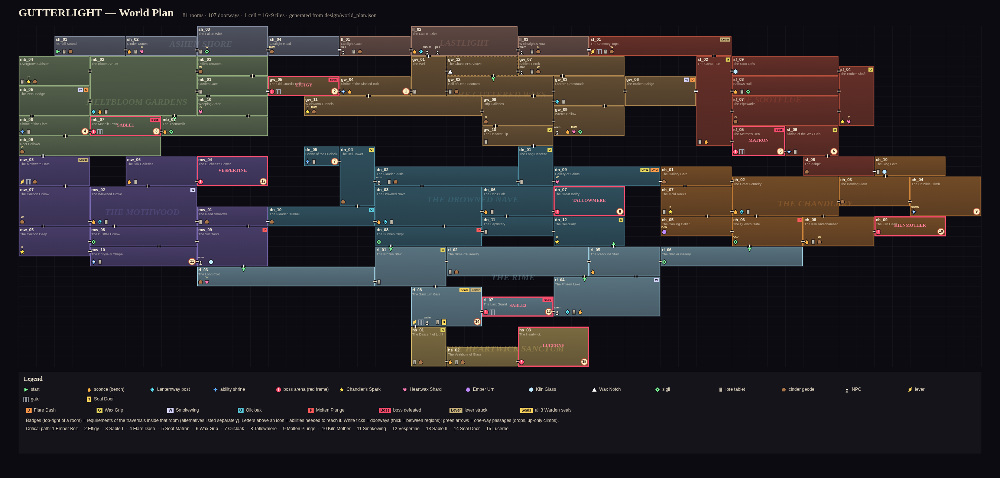

# GUTTERLIGHT - World Plan

Source of truth: `design/world_plan.json` (TECH_SPEC section 18), generated from the region DSL in
`tools/plan_gen/regions/*.js` by `node tools/plan_gen/build.js`; validated by `node tools/plan_check.js`;
map: `design/world_map.png` (`node tools/plan_render.js`). This document is generated by
`node tools/plan_gen/doc.js` - edit the DSL / the overviews in doc.js, never this file by hand.
Builders: read `docs/api/world_plan.md` first.

81 rooms. Global layout (cells of 16x9 tiles; west to east, top to bottom): Ashen Shore and
Lastlight on the surface, the Sootflue's Chimney Tops east of the village; Meltbloom Gardens, the Guttered Ways and
the Sootflue in the upper band; the Mothwood, the Drowned Nave and the Chandlery in the middle band; the Rime
underneath all three; the Heartwick Sanctum at the bottom.



## Macro connections

| Link | Rooms | Gate |
|---|---|---|
| Shore <-> Lastlight | sh_04 E1 / ll_01 W1 | open road |
| Lastlight -> Guttered | ll_02 S1 / gw_01 N1 (the Well) | none; the return climb uses one-way platforms (no abilities) |
| Lastlight <-> Flue | ll_03 E1 / sf_01 W1 | sf_gate1, opened by lever sf_lv1 on the Flue side (one-way shortcut) |
| Guttered <-> Meltbloom | gw_05 W1 / mb_01 E1 | the Effigy's west gate (boss:effigy) |
| Guttered <-> Flue | gw_06 E1 / sf_02 W1 | Broken Bridge: 10-tile gap (dash; wings also works) |
| Guttered <-> Nave | gw_10 S1 / dn_01 N1 | Descent Lip: 10-tile sheer wall before the pit; the Long Descent climb back needs grip |
| Flue <-> Chandlery | sf_06 (8-tile grip wall) / sf_08 E1 / ch_10 W1 | grip inside the Flue |
| Nave <-> Chandlery | dn_09 E1 / ch_01 W1 | Gallery of Saints: grip climb + 10-tile dash gap (back west is a free drop) |
| Nave <-> Mothwood | dn_10 W1 / mw_01 E1 | Flooded Tunnel: 51-wide meltwater under a 3-tile ceiling (oilcloak) |
| Meltbloom <-> Mothwood | mb_09 S1 / mw_03 N1 | mw_gate1, opened by lever mw_lv1 on the Mothwood side (one-way shortcut) |
| Nave -> Rime | dn_08 S1 / ri_01 N1 | cracked floor (plunge), one-way |
| Rime -> Nave | ri_05 N1 / dn_12 S1 | up-only Ice Stair (grip); its top ledge cannot be reached from the Nave |
| Chandlery -> Rime | ch_06 S1 / ri_06 N1 | cracked floor (plunge), one-way |
| Mothwood -> Rime | mw_09 S1 / ri_03 N1 | cracked floor (plunge), one-way |
| Rime <-> Sanctum | ri_08 S1 / hs_01 N1 | Seal Door (seals>=3), behind Sable's second duel (ri_07) |

## Critical path

DESIGN 4.2 order. Routes are the shortest exit-to-exit room sequences under the abilities held at that point (computed by plan_check).

```
INTENDED CRITICAL PATH
   1. bolt             @ gw_04   route: sh_01 > sh_02 > sh_03 > sh_04 > ll_01 > ll_02 > gw_01 > gw_04
   2. boss:effigy      @ gw_05   route: gw_04 > gw_05
   3. boss:sable1      @ mb_07   route: gw_05 > mb_01 > mb_10 > mb_08 > mb_07
   4. dash             @ mb_06   route: mb_07 > mb_06
   5. boss:matron      @ sf_05   route: mb_06 > mb_05 > mb_02 > mb_01 > gw_05 > gw_04 > gw_01 > gw_02 > gw_03 > gw_06 > sf_02 > sf_05
   6. grip             @ sf_06   route: sf_05 > sf_06
   7. lever:sf_lv1     @ sf_01   route: sf_06 > sf_05 > sf_02 > sf_01
   8. oilcloak         @ dn_05   route: sf_01 > sf_02 > gw_06 > gw_03 > gw_08 > gw_10 > dn_01 > dn_02 > dn_04 > dn_05
   9. boss:tallowmere  @ dn_07   route: dn_05 > dn_04 > dn_02 > dn_03 > dn_06 > dn_07
  10. plunge           @ ch_04   route: dn_07 > dn_06 > dn_03 > dn_02 > dn_01 > dn_09 > ch_01 > ch_02 > ch_03 > ch_04
  11. boss:kilnmother  @ ch_09   route: ch_04 > ch_03 > ch_02 > ch_08 > ch_09
  12. wings            @ mw_10   route: ch_09 > ch_08 > ch_02 > ch_01 > dn_09 > dn_01 > dn_02 > dn_03 > dn_10 > mw_01 > mw_09 > mw_10
  13. boss:vespertine  @ mw_04   route: mw_10 > mw_08 > mw_02 > mw_06 > mw_04
  14. lever:mw_lv1     @ mw_03   route: mw_04 > mw_06 > mw_02 > mw_07 > mw_03
  15. boss:sable2      @ ri_07   route: mw_03 > mw_07 > mw_02 > mw_01 > mw_09 > ri_03 > ri_01 > ri_02 > ri_04 > ri_07
  16. lever:ri_lv1     @ ri_08   route: ri_07 > ri_08
  17. boss:lucerne     @ hs_03   route: ri_08 > hs_01 > hs_02 > hs_03
```

```
ALTERNATIVE ORDERS: 18 feasible ability acquisition orders (of 720), e.g.
  bolt > dash > grip > oilcloak > wings > plunge
  bolt > dash > grip > oilcloak > plunge > wings
  bolt > dash > grip > plunge > oilcloak > wings
  dash > bolt > grip > oilcloak > wings > plunge
  dash > bolt > grip > oilcloak > plunge > wings
  dash > bolt > grip > plunge > oilcloak > wings
  dash > grip > bolt > oilcloak > wings > plunge
  dash > grip > bolt > oilcloak > plunge > wings
  dash > grip > bolt > plunge > oilcloak > wings
  dash > grip > oilcloak > bolt > wings > plunge
  dash > grip > oilcloak > bolt > plunge > wings
  dash > grip > oilcloak > wings > bolt > plunge
  dash > grip > oilcloak > wings > plunge > bolt
  dash > grip > oilcloak > plunge > bolt > wings
  dash > grip > oilcloak > plunge > wings > bolt
  dash > grip > plunge > bolt > oilcloak > wings
  dash > grip > plunge > oilcloak > bolt > wings
  dash > grip > plunge > oilcloak > wings > bolt
  keeper (seal) orders feasible: tallowmere > kilnmother > vespertine | tallowmere > vespertine > kilnmother | kilnmother > tallowmere > vespertine | kilnmother > vespertine > tallowmere | vespertine > tallowmere > kilnmother | vespertine > kilnmother > tallowmere
```

```
GATING TABLE (minimal ability sets that make each grant obtainable)
  dash             [dash]
  grip             [grip]
  wings            [wings]
  oilcloak         [oilcloak]
  plunge           [plunge]
  bolt             []
  boss:effigy      []
  boss:sable1      []
  boss:matron      [dash] or [wings]
  boss:tallowmere  [grip]
  boss:kilnmother  [dash,grip] or [grip,wings]
  boss:vespertine  [grip,wings,oilcloak]
  boss:sable2      [grip,wings,plunge]
  boss:lucerne     [grip,wings,oilcloak,plunge]
  lever:sf_lv1     [dash,grip] or [grip,wings]
  lever:mw_lv1     [grip,oilcloak]
  lever:ri_lv1     [grip,wings,plunge]
```


## Shortcuts, loops, secrets, no-trap

```
NO-TRAP: checked in all 378 states: 0 trapped positions; 0 positions whose only way home needs a lever on the player's own side (both must be 0).

LOOPS per region (cycle rank): shore 0, lastlight 0, guttered 5, meltbloom 3, flue 2, nave 2, chandlery 3, mothwood 4, rime 2, sanctum 0
ONE-WAY SHORTCUTS (10):
  sf_01: lever gate sf_gate1 (lever:sf_lv1)
  mw_03: lever gate mw_gate1 (lever:mw_lv1)
  ri_08: lever gate ri_gate1 (lever:ri_lv1)
  gw_12 -> gw_02 (one-way passage)
  mb_02 -> mb_08 (one-way passage)
  dn_08 -> ri_01 (one-way passage)
  ri_05 -> dn_12 (one-way passage)
  ch_06 -> ri_06 (one-way passage)
  mw_09 -> ri_03 (one-way passage)
  ri_02 -> ri_04 (one-way passage)
SECRETS behind breakable walls (17):
  sh_01 geode:sh_geo1: breakable wall (B, 3 tall) in the west cliff face at floor level
  ll_01 geode:ll_geo1: breakable wall (B) under the gatehouse stair, east side
  gw_09 pickup:gw_sig_ember_thirst: breakable wall (B) behind Wren's tent at the west end of the lower floor
  room gw_12: reached only through breakable walls (the Well, gw_01 east wall at mid height; or Sable's Perch, gw_07 west end); its floor hole drops into the Hall of Dead Sconces
  mb_04 geode:mb_geo3: breakable wall (B) at the west end of the courtyard
  mb_08 pickup:mb_sig_thorned_wax: breakable hedge wall (B) at the east end
  sf_03 pickup:sf_sig_swift_brand: breakable brickwork (B) in the low ceiling, reached from a raised shelf
  sf_04 pickup:spark_sf: breakable wall (B) on the top landing
  sf_08 geode:sf_geo3: breakable wall (B) of compacted ash at the west end
  dn_04 geode:dn_geo3: breakable wall (B) behind the bell frame on the east ledge at the top of the climb
  dn_08 pickup:dn_sig_bright_bolt: breakable wall (B) of a burial niche at the west end
  ch_10 pickup:ch_kg: breakable wall (B) of slag bricks at the east end
  ch_05 pickup:ch_urn: breakable wall (B) of stacked cold molds, then a dash over a quench trough
  mw_08 pickup:mw_sig_last_light: breakable wall (B) of dust-caked silk in the low ceiling, reached from a root ledge
  mw_09 pickup:mw_kg: breakable wall (B) of silt behind Wren's camp
  ri_06 pickup:ri_sig_deep_kindle: breakable wall (B) of packed snow at the east end
  hs_02 geode:hs_geo2: breakable crystal wall (B) on the north side
```


## Backtracking rewards

Optional rewards in earlier regions that each later ability unlocks (every way to the reward needs an ability, one of them this one):

```
BACKTRACKING REWARDS (optional rewards in earlier regions unlocked by each later ability):
  dash     (meltbloom): 3  sh_04 geode:sh_geo2; gw_09 pickup:gw_hw1; gw_11 geode:gw_geo4
  grip     (flue): 3  sh_02 pickup:sh_hw1; ll_03 geode:ll_geo2; mb_10 pickup:mb_hw1
  wings    (mothwood): 11  sh_03 pickup:sh_sig_heartwax; sh_04 geode:sh_geo2; gw_07 geode:gw_geo3; gw_09 pickup:gw_hw1; gw_11 geode:gw_geo4; mb_03 geode:mb_geo1; sf_01 geode:sf_geo1; dn_09 pickup:dn_hw1; ch_05 pickup:ch_urn; ch_06 pickup:ch_sig_flare_trail; ch_08 geode:ch_geo3
  oilcloak (nave): 3  gw_08 geode:gw_geo2; mb_09 geode:mb_geo2; sf_07 geode:sf_geo2
  plunge   (chandlery): 4  gw_11 pickup:spark_gw; mb_04 pickup:spark_mb; sf_04 pickup:sf_hw1; dn_12 pickup:spark_dn
```


## Collectibles (where everything is)

- **Abilities:** `shrine:bolt` gw_04, `shrine:dash?boss:sable1` mb_06, `shrine:grip?boss:matron` sf_06, `shrine:oilcloak` dn_05, `shrine:plunge` ch_04, `shrine:wings` mw_10
- **Bosses:** `arena:effigy` gw_05, `arena:sable1` mb_07, `arena:matron` sf_05, `arena:tallowmere` dn_07, `arena:kilnmother` ch_09, `arena:vespertine` mw_04, `arena:sable2` ri_07, `arena:lucerne` hs_03
- **Chandler's Sparks:** `pickup:spark#spark_gw` gw_11, `pickup:spark#spark_mb` mb_04, `pickup:spark#spark_sf` sf_04, `pickup:spark#spark_dn` dn_12, `pickup:spark#spark_ch` ch_07, `pickup:spark#spark_mw` mw_05
- **Heartwax Shards:** `pickup:heartwax#sh_hw1` sh_02, `pickup:heartwax#gw_hw1` gw_09, `pickup:heartwax#mb_hw1` mb_10, `pickup:heartwax#sf_hw1` sf_04, `pickup:heartwax#dn_hw1` dn_09, `pickup:heartwax#ri_hw1` ri_03
- **Ember Urn, Kiln Glass, Wax Notch:** `pickup:notch#gw_notch` gw_12, `pickup:kiln_glass#sf_kg` sf_09, `pickup:kiln_glass#ch_kg` ch_10, `pickup:urn#ch_urn` ch_05, `pickup:kiln_glass#mw_kg` mw_09
- **Sigils:** `pickup:sigil:heartwax#sh_sig_heartwax` sh_03, `pickup:sigil:ember_thirst#gw_sig_ember_thirst` gw_09, `pickup:sigil:thorned_wax#mb_sig_thorned_wax` mb_08, `pickup:sigil:swift_brand#sf_sig_swift_brand` sf_03, `pickup:sigil:bright_bolt#dn_sig_bright_bolt` dn_08, `pickup:sigil:flare_trail#ch_sig_flare_trail` ch_06, `pickup:sigil:last_light#mw_sig_last_light` mw_08, `pickup:sigil:deep_kindle#ri_sig_deep_kindle` ri_06
- **Sconces:** `sconce:sh_sconce_a` sh_02, `sconce:ll_sconce_a` ll_02, `sconce:gw_sconce_a` gw_04, `sconce:gw_sconce_b` gw_09, `sconce:mb_sconce_a` mb_02, `sconce:mb_sconce_b` mb_08, `sconce:sf_sconce_b` sf_02, `sconce:sf_sconce_a` sf_03, `sconce:dn_sconce_a` dn_03, `sconce:dn_sconce_b` dn_06, `sconce:ch_sconce_a` ch_02, `sconce:ch_sconce_b` ch_08, `sconce:mw_sconce_a` mw_02, `sconce:mw_sconce_b` mw_06, `sconce:ri_sconce_a` ri_05, `sconce:ri_sconce_b` ri_04, `sconce:hs_sconce_a` hs_02
- **Lanternway posts:** `lanternway:lastlight` ll_02, `lanternway:guttered` gw_03, `lanternway:meltbloom` mb_02, `lanternway:nave` dn_03, `lanternway:chandlery` ch_02, `lanternway:mothwood` mw_02, `lanternway:rime` ri_04
- **NPCs:** `npc:quill` ll_01, `npc:thrum` ll_02, `npc:pell` ll_02, `npc:bramm` ll_03, `npc:sable:1` gw_07, `npc:wren:1` gw_09, `npc:wren:2` dn_02, `npc:wren:3` mw_09, `npc:wren:4` ri_04, `npc:sable:2` ri_08
- **Levers, gates, Seal Door, start:** `start` sh_01, `gate:gw_gate1?boss:effigy` gw_05, `gate:mb_gate9?boss:sable1` mb_07, `lever:sf_lv1` sf_01, `gate:sf_gate1?lever:sf_lv1` sf_01, `gate:sf_gate9?boss:matron` sf_05, `lever:mw_lv1` mw_03, `gate:mw_gate1?lever:mw_lv1` mw_03, `gate:ri_gate9?boss:sable2` ri_07, `lever:ri_lv1` ri_08, `gate:ri_gate1?lever:ri_lv1` ri_08, `sealdoor` ri_08

## Ashen Shore (shore, 4 rooms)

The tutorial strip on the grey surface. The Wickling wakes on an ash mound (sh_01) and walks east past three control carvings toward the warm windows of Lastlight. Everything here is safe and readable; the region exists to teach walking, jumping, attacking and pogo, and to plant three promises (a grip pillar, a dash ledge, a wings crown) that pay off much later.

- **Landmarks:** **The Fallen Wick** (sh_03): a colossal toppled candle lying across the dunes - the first unforgettable silhouette.
- **Gating:** Grip (sh_hw1 on the ash pillar in sh_02), dash or wings (sh_geo2 on the detached ledge in sh_04), wings (Stubborn Heartwax sigil on the candle's crown in sh_03).
- **Secrets:** sh_01: breakable cliff face hiding sh_geo1 (teaches that walls can break).

### sh_01 - Ashfall Strand (surface, 64x18 tiles at gx 32, gy 9)

- Exits: E1 rows 11-13 -> sh_02.W1
- Contents: `start`, `lore:lore_sh_1`, `geode:sh_geo1`, `enemy:ash_crawler*1`, `landmark:the Wickling wakes on an ash mound at the edge of a dead grey ash sea; a broken pier juts west`

Surface beach, open slate sky (rows 0-8 air). Ground top at row 14 (rows 14-17 solid), gentle 1-tile dunes. West: sheer ash cliff filling cols 0-5 full height; at cols 4-5 rows 11-13 a B section hides a 3x3 pocket (cols 1-3) holding sh_geo1 - the first secret, teaches that walls can break. start marker at col 10 (feet on row 14 mound). lore_sh_1 carving at col 18: teaches {left}/{right} and {jump}; right after it a 2-tile step and a 4-tile ledge to practise a full jump. One ash_crawler near col 50. Calm, no hazards. Exit E1 at rows 11-13.

### sh_02 - Cinder Dunes (surface, 64x18 tiles at gx 96, gy 9)

- Exits: E1 rows 11-13 -> sh_03.W1; W1 rows 11-13 -> sh_01.E1
- Traversals: E1->W1: free; W1->E1: free
- Gated spots: pickup:sh_hw1 (grip from E1 | grip from W1)
- Contents: `sconce:sh_sconce_a`, `lore:lore_sh_2`, `pickup:heartwax#sh_hw1`, `enemy:ash_crawler*2`, `enemy:ash_fly*1`, `landmark:a half-buried stone sconce glowing faintly on a dune crest - the first rest`

Rolling ash dunes, ground top row 14. sh_sconce_a on a flat crest around col 20 (first save; place a light). lore_sh_2 at col 28 teaches {attack} (and that strikes fill the Ember well); two ash_crawlers after it, one ash_fly hovering near the east. GRIP GATE: at the east end (cols 52-60) a sheer petrified-ash pillar rises from the floor to row 4 (10 tiles, no footholds; its west face is plain # so grip works, no platforms). sh_hw1 sits on its flat top (row 3) - visible from the sconce. Drop back down freely. Ensure the pillar does not block the walkway to E1 (leave a 4-tall tunnel through its base or put it in the background half of the room: e.g. the walkway runs under an overhang).

### sh_03 - The Fallen Wick (landmark, 64x27 tiles at gx 160, gy 0)

- Exits: E1 rows 20-22 -> sh_04.W1; W1 rows 20-22 -> sh_02.E1
- Traversals: E1->W1: free; W1->E1: free
- Gated spots: pickup:sh_sig_heartwax (wings from E1 | wings from W1)
- Contents: `lore:lore_sh_3`, `pickup:sigil:heartwax#sh_sig_heartwax`, `enemy:ash_fly*2`, `enemy:ash_crawler*1`, `landmark:a colossal toppled candle as big as a tower lies across the dunes; its dead wick is buried in the ash`

Tall surface room (27 rows), ground top row 23 at both exits (rows 20-22 open). The colossal candle lies diagonally from upper-left (its flat base end, rows 8-12, cols 4-20) down to its wick buried at the lower right (col 44). Walkway: the player walks over/through the candle body (rounded wax slope of 1-tile steps). Pogo lesson: lore_sh_3 (teaches {down}+{attack} in the air to bounce) right before a 5-wide thorn pit (^) in the floor around cols 34-38 - crossable by plain jump, but the carving invites pogo practice; a second short thorn strip on the candle top. WINGS GATE: the candle base end forms a raised "crown" ledge whose top (row 8) is 7 tiles above the highest reachable candle surface (row 15) with GLAZED (X) smooth wax sides - only Smokewing reaches it. sh_sig_heartwax (Stubborn Heartwax sigil) rests in the dead wick-cup on the crown. Ash flies hover over the pit.

### sh_04 - Lastlight Road (surface, 64x18 tiles at gx 224, gy 9)

- Exits: E1 rows 11-13 -> ll_01.W1; W1 rows 11-13 -> sh_03.E1
- Traversals: E1->W1: free; W1->E1: free
- Gated spots: geode:sh_geo2 (dash from E1 | wings from E1 | dash from W1)
- Contents: `geode:sh_geo2`, `enemy:ash_crawler*2`, `enemy:ash_fly*1`, `landmark:a road of ash-buried lamp posts leading east to the warm windows of Lastlight`

Road toward the village, ground top row 14, lamp posts (decor) every ~8 cols, faint warm light from the east. DASH GATE (optional): a rocky outcrop at cols 16-21 climbs from the road in two 3-tile steps to a flat top at row 8; from its east lip a 10-tile gap (cols 22-31, no footholds, road far below) separates it from a detached ash ledge at cols 32-36, also top row 8, holding sh_geo2. The ledge is 6 tiles above the road with no walls nearby and GLAZED (X) faces, so it cannot be jumped or gripped to from below (Smokewing can, which is fine); a failed dash simply drops you onto the road. Two ash_crawlers on the road, one ash_fly. E1 rows 11-13 into the village gate.

## Lastlight (lastlight, 3 rooms)

The last lit village of Tallowdeep and the emotional hub: no enemies, warm windows, the Last Brazier. Quill (charts), Old Thrum and Pell (shop) and Bramm (smith) live here; ll_02 holds the home sconce and the Lanternway post. The Well in the village square drops straight into the Guttered Ways, and its return climb needs no abilities. The east road ends at the Flue shortcut gate, whose lever is on the far side.

- **Landmarks:** **The Last Brazier** square with **the Well** (ll_02).
- **Gating:** Grip (ll_geo2 on the forge chimney in ll_03). The Flue gate sf_gate1 (lever on the Flue side) is visible from ll_03 from the first visit.
- **Secrets:** ll_01: a breakable wall under the gatehouse stair hides ll_geo1.

### ll_01 - Lastlight Gate (village, 64x18 tiles at gx 288, gy 9)

- Exits: E1 rows 11-13 -> ll_02.W1; W1 rows 11-13 -> sh_04.E1
- Traversals: E1->W1: free; W1->E1: free
- Contents: `npc:quill`, `lore:lore_ll_1`, `geode:ll_geo1`, `landmark:two leaning candle-stub towers flank the village gate, their windows glowing amber`

Village edge, safe room (no enemies). Ground top row 14. Two candle-stub tower silhouettes frame a wooden gate arch at cols 8-12 (decor, walk-through). Quill sits at a map table under a lamppost at col 22 with ink pots (her stall). lore_ll_1 = the founding stone of Lastlight at col 34. SECRET: the gatehouse stair (solid block cols 44-50, rows 11-13 with steps) has a B face at col 50 rows 12-13 opening into a 2-tall crawlspace cellar (cols 51-58) with ll_geo1. Warm window lights.

### ll_02 - The Last Brazier (hub, 96x27 tiles at gx 352, gy 0)

- Exits: E1 rows 20-22 -> ll_03.W1; S1 cols 14-17 -> gw_01.N1; W1 rows 20-22 -> ll_01.E1
- Traversals: E1->S1: free; E1->W1: free; S1->E1: free; S1->W1: free; W1->E1: free; W1->S1: free
- Contents: `sconce:ll_sconce_a`, `lanternway:lastlight`, `npc:thrum`, `npc:pell`, `landmark:the Last Brazier - a great iron brazier in the village square holding the last weak orange fire of Tallowdeep`, `landmark:the Well - a round stone well-mouth with a broken winch, the way down into the dark`

EMOTIONAL HUB, safe, music lastlight. 96x27, dusk sky above rows 0-12, village floor top row 23 (W1/E1 rows 20-22). Huddled candle-stub houses with warm windows in the background, a few on platforms (=) as rooftops reachable for fun. THE WELL (S1, cols 14-17): stone rim; the square floor dips into a 2-deep ring around the hole (ring floor top at row 25 for cols 10-13 and 18-21; the hole cols 14-17 open through rows 23-26) so a player rising out of the Well (exit boost ~3 tiles) lands on the ring, then hops 2 tiles up to the square. The Last Brazier stands at the centre (cols 44-51, big warm light r~8). Old Thrum beside it (col 41); ll_sconce_a right of it (col 55) - this is the Lastlight sconce (home respawn). Pell with his huge pack at col 64 under an awning. Lanternway post lastlight at col 78 near the east road. No enemies, no hazards.

### ll_03 - Wickwright's Row (village, 64x18 tiles at gx 448, gy 9)

- Exits: E1 rows 11-13 -> sf_01.W1; W1 rows 11-13 -> ll_02.E1
- Traversals: E1->W1: free; W1->E1: free
- Gated spots: geode:ll_geo2 (grip from E1 | grip from W1)
- Contents: `npc:bramm`, `lore:lore_ll_2`, `geode:ll_geo2`, `landmark:Bramm's open forge - an anvil under a lean-to, red forge glow and hanging tools`

East end of the village, safe. Ground top row 14. Bramm at his anvil (col 20), forge glow light. lore_ll_2 on a smith-guild plaque (col 30). GRIP REWARD: the forge chimney, a sheer brick column at cols 36-38 rising from the floor to row 4 (10 tiles, no ledges), ll_geo2 sits on its cap. East end (cols 56-63): the road continues toward the chimney-tops; the Flue shortcut gate stands just inside sf_01 (players see bars and a lever beyond). E1 is the opening at rows 11-13 (floor top row 14); keep the road's interior 4 tiles tall (air rows 10-13) toward the east edge so it matches the gate passage just inside sf_01.

## The Guttered Ways (guttered, 12 rooms)

The crossroads beneath Lastlight: brick halls lined with dead sconces. From the Well the player finds the Ember Bolt shrine (gw_04) right before the Effigy's hall (gw_05), whose west gate opens to Meltbloom only after the Effigy falls. East, the Broken Bridge (gw_06, dash) leads to the Sootflue; down, the Descent Lip (gw_10, grip) leads to the Drowned Nave. Wren's camp (gw_09) and the Lantern Crossroads (gw_03, Lanternway) are the natural rest points. Loops: Well - Hall - Crossroads - Drip Galleries; Bolt shrine - Wickworm Tunnels - Drip Galleries - Hall - Well; Crossroads - Drip Galleries - Wren's Hollow.

- **Landmarks:** **Hall of Dead Sconces** (gw_02), **Lantern Crossroads** (gw_03), **The Broken Bridge** (gw_06), **Sable's Perch** (gw_07, first glimpse of Sable).
- **Gating:** Effigy (boss gate west), dash or wings (Broken Bridge, gw_hw1, gw_geo4), grip (Descent Lip), oilcloak (gw_geo2 cistern), plunge (spark_gw vault), wings (gw_geo3 on the Perch).
- **Secrets:** The Chandler's Alcove (gw_12) is a whole secret room behind breakable walls in the Well and in Sable's Perch, with the hidden Wax Notch and a one-way drop back into the Hall; Wren's tent hides the Ember Thirst niche (gw_09).

### gw_01 - The Well (shaft, 32x36 tiles at gx 352, gy 27)

- Exits: E1 rows 12-14 -> gw_12.W1; E2 rows 30-32 -> gw_02.W1; N1 cols 14-17 -> ll_02.S1; W1 rows 30-32 -> gw_04.E1
- Traversals: E1->E2: free; E1->N1: free; E1->W1: free; E2->E1: free; E2->N1: free; E2->W1: free; N1->E1: free; N1->E2: free; N1->W1: free; W1->E1: free; W1->E2: free; W1->N1: free
- Contents: `lore:lore_gw_1`, `enemy:drip_fly*2`, `landmark:the bottom of the Well - a round brick chamber; daylight from Lastlight falls in a thin shaft from far above`

Vertical brick shaft, the way down from Lastlight; must be climbable back up with NO abilities. One-way platforms (=, 5-7 wide) zig-zag left/right with at most 4 rows between tops: rows 30, 26, 22, 18, 14 (west side, clear of the east ledge), 10, 7 and a final one at row 4 spanning cols 13-18, directly under N1 so a full jump carries the player up through the opening. Bottom chamber: floor top row 33, W1 and E1 at rows 30-32 lead to the Bolt shrine (west) and the Hall of Dead Sconces (east). lore_gw_1 (a well-keeper plaque) on the bottom wall. SECRET: on the east wall a solid ledge (top row 15, cols 22-30) sits in front of a B wall (cols 29-30, rows 12-14) that hides E2 -> The Chandler's Alcove. Two drip_flies in the lower half. Dim shaft of light from above.

### gw_02 - Hall of Dead Sconces (hall, 96x18 tiles at gx 384, gy 45)

- Exits: E1 rows 12-14 -> gw_03.W1; N1 cols 40-43 -> gw_12.S1; S1 cols 76-79 -> gw_08.N1; W1 rows 12-14 -> gw_01.E2
- Traversals: E1->S1: free; E1->W1: free; N1->E1: free; N1->S1: free; N1->W1: free; S1->E1: free; S1->W1: free; W1->E1: free; W1->S1: free
- Contents: `lore:lore_gw_2`, `geode:gw_geo1`, `enemy:snuffed_walker*3`, `enemy:drip_fly*1`, `landmark:a long vaulted hall lined with two rows of dead iron sconces, each holding a cold black wick`

Long corridor (96 wide), floor top row 15 (W1/E1 rows 12-14), vaulted ceiling around row 3 with brick arches every 12 cols; rows of dead sconces as decor along the back wall (the region's signature image). Three snuffed_walkers spaced along the floor, one drip_fly. N1 (cols 40-43) is a hole in the ceiling 15 tiles up - unreachable from here; it is where a player drops in from the secret Alcove (one-way). S1 (cols 76-79) is a hole in the floor down to the Drip Galleries: around it lower the floor to top row 16 for 3 cols each side (landing ledge for players rising from below). gw_geo1 in an alcove of the south wall near col 20 (no gate). lore_gw_2: the lamplighters' roll-call carved on a pillar at col 60.

### gw_03 - Lantern Crossroads (hub, 64x27 tiles at gx 480, gy 45)

- Exits: E1 rows 12-14 -> gw_06.W1; N1 cols 6-9 -> gw_07.S1; S1 cols 44-47 -> gw_09.N1; W1 rows 12-14 -> gw_02.E1; W2 rows 21-23 -> gw_08.E1
- Traversals: E1->N1: free; E1->S1: free; E1->W1: free; E1->W2: free; N1->E1: free; N1->S1: free; N1->W1: free; N1->W2: free; S1->E1: free; S1->N1: free; S1->W1: free; S1->W2: free; W1->E1: free; W1->N1: free; W1->S1: free; W1->W2: free; W2->E1: free; W2->N1: free; W2->S1: free; W2->W1: free
- Contents: `lanternway:guttered`, `lore:lore_gw_3`, `enemy:snuffed_lancer*1`, `enemy:wick_crawler*1`, `landmark:a four-way crossroads beneath a huge hanging iron lantern-frame, long dead; signposts point to Lastlight, the bridge and the deep`

HUB (64x27). Mid floor top row 15 joins W1 (rows 12-14, from the Hall) and E1 (rows 12-14, to the Broken Bridge). Lower floor top row 24 joins W2 (rows 21-23, Drip Galleries) and S1 (cols 44-47, down to Wren's Hollow); connect mid and lower floors with 3-4 tile steps/platforms. N1 (cols 6-9) up to Sable's Perch: a stair of one-way platforms on the west side (tops rows 11, 7, 4; the last directly under N1). Lanternway post guttered on the mid floor at col 30 (with a light). lore_gw_3 = the Queen's decree "No flame shall gutter" on a signpost stone. One snuffed_lancer on the mid floor, a wick_crawler on the lower floor. S1 hole: floor around it at top row 25 (landing ledge for players rising from below).

### gw_04 - Shrine of the Kindled Bolt (shrine, 64x18 tiles at gx 288, gy 45)

- Exits: E1 rows 12-14 -> gw_01.W1; S1 cols 24-27 -> gw_11.N1; W1 rows 12-14 -> gw_05.E1
- Traversals: E1->S1: free; E1->W1: free; S1->E1: free; S1->W1: free; W1->E1: free; W1->S1: free
- Contents: `shrine:bolt`, `sconce:gw_sconce_a`, `landmark:a small brick chapel; a pedestal holds a floating blue ember amid melted votive candles`

Main path, no enemies (sanctuary before the Effigy). Floor top row 15 (W1/E1 rows 12-14). Bolt shrine pedestal at col 34 under a skylight shaft; gw_sconce_a at col 46 (the sconce near the Effigy arena). The west doorway (W1) leads into the Effigy's hall: make it a heavy stone arch. S1 (cols 24-27) is a hole in the floor dropping into the Wickworm Tunnels (floor around it top row 16). Teaching moment: after taking the bolt, a breakable-looking crate or a dummy target is optional; do not add hazards.

### gw_05 - The Old Guard's Hall (arena, 64x18 tiles at gx 224, gy 45)

- Exits: E1 rows 12-14 -> gw_04.W1; W1 rows 12-14 -> mb_01.E1
- Traversals: E1->W1: boss:effigy; W1->E1: boss:effigy
- Gated spots: arena:effigy (boss:effigy from W1)
- Contents: `arena:effigy`, `gate:gw_gate1?boss:effigy`, `landmark:a giant cracked statue of a royal guard kneels in the dark, an iron snuffer-cap hammer across its knees`

BOSS ARENA - THE EFFIGY (64x18). Flat floor top row 15 across cols 1-62 (rows 15-17 solid); ceiling rows 0-2 solid with a few cracked stalactite clusters (debris-fall spawn points along row 3). W1 and E1 at rows 12-14; just inside both, keep rows 11-14 open for 3 cols and solid ceiling at row 10 above them so gates fit. gw_gate1 (w1,h4, opens boss:effigy) at col 2 rows 11-14 - closed until the Effigy falls, it is the way west to Meltbloom. arena_gate (w1,h4) at col 61 rows 11-14 (closes behind the player during the fight). arena entity: boss effigy, spawn bx=18, by=14 (kneeling statue, west half), trigger rect cols 26-50 rows 6-14 (entering from the east). No platforms, no hazards (the hammer shockwaves need a clean floor); the room is wide enough to dodge leaps. After victory: 200 cinders burst (boss reward), both gates open.

### gw_06 - The Broken Bridge (gate, 64x27 tiles at gx 544, gy 45)

- Exits: E1 rows 12-14 -> sf_02.W1; W1 rows 12-14 -> gw_03.E1
- Traversals: E1->W1: dash or wings; W1->E1: dash or wings
- Contents: `enemy:drip_fly*2`, `landmark:a great stone bridge broken in the middle over a black chasm; the red glow of the Sootflue flickers beyond`

DASH GATE between the Guttered Ways and the Sootflue. Room 64x27. Bridge deck top row 15 at both ends (W1/E1 rows 12-14), deck 2 tiles thick (rows 15-16) resting on piers. The span is collapsed between cols 26 and 34: a 9-tile gap at equal height (deck ends at col 25 and resumes at col 35; critical-path dash gaps are 9 tiles, 10 only for optional rewards), no ledges, chains or walls within it. Below the gap the chasm drops 9 tiles to a spike bed (^ at row 24 over solid rows 25-26): too deep to pogo back up, so a fall costs 1 health and respawns on the near deck. The chasm walls (the deck ends and piers, cols 25 and 35 downward) are GLAZED (X) so Wax Grip cannot climb out on the far side. Ceiling high (row 4 or above) so the dash+jump arc is not blocked. Visually: broken balustrade, hanging rubble, a deep dark void, the Flue's ember-light from the east. Two drip_flies hover over the gap (they can be pogo-ed but must not be required).

### gw_07 - Sable's Perch (room, 96x18 tiles at gx 448, gy 27)

- Exits: S1 cols 38-41 -> gw_03.N1; W1 rows 12-14 -> gw_12.E1
- Traversals: S1->W1: free; W1->S1: free
- Gated spots: geode:gw_geo3 (wings from S1 | wings from W1)
- Contents: `npc:sable:1`, `lore:lore_gw_4`, `geode:gw_geo3`, `enemy:snuffed_lancer*2`, `landmark:the broken top of an old belfry; a black-wax figure with a long red scarf watches from a high beam, then is gone`

Upper room (96x18) reached from the Crossroads below via S1 (cols 38-41). Floor top row 15 (broken masonry, 1-tile bumps); around the S1 hole the floor dips to top row 16 for 3 cols on each side (landing ledge for players rising out of the Crossroads). SABLE GLIMPSE: npc sable stage 1 (event) stands on a high beam (top row 4, cols 70-76, unreachable without wings) and leaves when the player comes within ~10 tiles; foreshadows her duel. lore_gw_4: a guard-captain's order "hold the deep ways" at col 52. Two snuffed_lancers. WINGS REWARD: a ledge at cols 84-90, top row 8, 7 tiles above the floor with GLAZED (X) faces and no wall within 6 tiles, holds gw_geo3. SECRET: a B wall (cols 2-3, rows 12-14) hides W1 -> the Chandler's Alcove (W1 rows 12-14 open at col 0 behind it; floor top row 15).

### gw_08 - Drip Galleries (room, 64x27 tiles at gx 416, gy 63)

- Exits: E1 rows 3-5 -> gw_03.W2; E2 rows 21-23 -> gw_09.W1; N1 cols 44-47 -> gw_02.S1; S1 cols 10-13 -> gw_10.N1; W1 rows 12-14 -> gw_11.E1
- Traversals: E1->E2: free; E1->N1: free; E1->S1: free; E1->W1: free; E2->E1: free; E2->N1: free; E2->S1: free; E2->W1: free; N1->E1: free; N1->E2: free; N1->S1: free; N1->W1: free; S1->E1: free; S1->E2: free; S1->N1: free; S1->W1: free; W1->E1: free; W1->E2: free; W1->N1: free; W1->S1: free
- Gated spots: geode:gw_geo2 (oilcloak from E1 | oilcloak from E2 | oilcloak from N1)
- Contents: `geode:gw_geo2`, `enemy:drip_fly*2`, `enemy:wick_crawler*2`, `landmark:a cavern of wax stalactites that drip constantly into pale pools`

Cave junction (64x27) with many levels, all connected without abilities. N1 (cols 44-47) from the Hall above: a one-way platform under it with top at row 4, reachable by a stair of ledges. E1 (rows 3-5, floor top row 6) is a high east ledge to the Crossroads' lower floor. W1 (rows 12-14, floor top row 15) to the Wickworm Tunnels. E2 (rows 21-23, floor top row 24) to Wren's Hollow. S1 (cols 10-13) a hole in the bottom floor down to the Descent Lip (floor around it top row 25). OILCLOAK REWARD: in the bottom-west a meltwater pool (~16 wide, cols 16-31, surface row 22) runs under a low rock vault (2-3 tiles of air above the water) into a small dry pocket holding gw_geo2. Wick_crawlers on the lower floor, drip_flies in the upper air.

### gw_09 - Wren's Hollow (room, 64x27 tiles at gx 480, gy 72)

- Exits: N1 cols 44-47 -> gw_03.S1; W1 rows 12-14 -> gw_08.E2
- Traversals: N1->W1: free; W1->N1: free
- Gated spots: pickup:gw_hw1 (dash from N1 | wings from N1 | dash from W1)
- Contents: `npc:wren:1`, `sconce:gw_sconce_b`, `pickup:heartwax#gw_hw1`, `pickup:sigil:ember_thirst#gw_sig_ember_thirst`, `enemy:wick_crawler*1`, `landmark:a sheltered hollow where a small traveler with a snuffer-cap hat has pitched a tent beside a tiny fire`

Camp room (64x27). N1 (cols 44-47) drops in from the Crossroads: a one-way platform under it at top row 4 with ledges down to the camp. Main floor top row 15 (W1 rows 12-14 to the Drip Galleries). Wren (stage 1) sits by her fire at col 20; gw_sconce_b at col 30. SECRET: behind Wren's tent the west wall (cols 2-3, rows 12-14) is B -> a 6x3 niche with the Ember Thirst sigil. DASH REWARD: on the east side the floor ends at col 46 at a drop into a deep crack (spikes ^ at row 25); across a 10-tile gap (cols 47-56) a ledge at top row 15 (cols 57-61) holds gw_hw1; nothing to stand on in between and no walls within reach. The crack walls (col 46 downward and col 57 downward) are GLAZED (X) so grip cannot climb out to the ledge; the spikes are 10 tiles down (too deep to pogo back). One wick_crawler patrols near the crack.

### gw_10 - The Descent Lip (gate, 64x18 tiles at gx 416, gy 90)

- Exits: N1 cols 10-13 -> gw_08.S1; S1 cols 44-47 -> dn_01.N1
- Traversals: N1->S1: grip; S1->N1: free
- Contents: `lore:lore_gw_5`, `enemy:snuffed_walker*1`, `landmark:a sheer wall of glistening wax; beyond its rim a black pit breathes cold wet air and the sound of rain`

GRIP GATE to the Drowned Nave (the descent entrance must be unreachable without grip). N1 (cols 10-13): players drop in from the Drip Galleries; a stair of ledges leads back up (platform top row 4 under N1). West floor top row 15 (cols 1-30). At col 31 a SHEER wall rises from row 15 to a plateau top at row 5 (10 tiles; # grippable, absolutely no footholds, nothing to pogo); plateau spans cols 31-40. East of it a narrow pit (cols 41-50, walls #) drops from row 5 to S1 (cols 44-47) and on into the Long Descent. Climbing back up from the pit needs grip (wall-jumps on the pit walls), then the player drops off the plateau to the floor. lore_gw_5, a warning carved at col 20: "below, the rain never stops". One snuffed_walker on the floor.

### gw_11 - Wickworm Tunnels (corridor, 160x18 tiles at gx 256, gy 63)

- Exits: E1 rows 12-14 -> gw_08.W1; N1 cols 56-59 -> gw_04.S1
- Traversals: E1->N1: free; N1->E1: free
- Gated spots: pickup:spark_gw (plunge from E1 | plunge from N1); geode:gw_geo4 (dash from E1 | wings from E1 | dash from N1)
- Contents: `pickup:spark#spark_gw`, `geode:gw_geo4`, `enemy:wick_crawler*3`, `enemy:snuffed_walker*2`, `landmark:long low tunnels bored through old wax by wickworms; the walls are ribbed with their spiral tracks`

Long corridor (160x18). Main floor top row 15 (E1 rows 12-14 to the Drip Galleries). N1 (cols 56-59) is the hole from the Bolt shrine above: provide one-way platforms below it (tops rows 12, 8, 4; the last directly under N1) so players can climb back up. Mild undulation, wick_crawlers on floor and ceiling, snuffed_walkers. West end (cols 1-30): the floor climbs in 3-tile steps to a raised shelf with top row 9; part of that shelf (cols 8-13, rows 9-10) is a cracked floor D. PLUNGE REWARD: under the D floor a hidden vault (cols 3-20, rows 11-15) holds Chandler's Spark spark_gw on a small altar; inside the vault a one-way platform (=, top row 13) right beside the hole lets the player climb back out through the broken hole (vault floor top row 16 -> platform 3 up -> shelf surface 4 up). Before plunge the D floor just looks like old cracked stone - a visible promise. DASH REWARD (gw_geo4): in the east half (cols 100-140) the tunnel ceiling opens into a wormhole gallery: a ledge at top row 9 (cols 104-108) reachable by 3-tile steps faces, across a 10-tile gap at equal height (cols 109-118, nothing to stand on, no walls in reach), a shelf at cols 119-124 (top row 9, faces GLAZED X so it cannot be gripped from the floor 6 tiles below) holding gw_geo4; the floor below stays walkable, so a failed dash just drops you back onto the tunnel floor.

### gw_12 - The Chandler's Alcove (secret, 64x18 tiles at gx 384, gy 27)

- Exits: E1 rows 12-14 -> gw_07.W1; S1 cols 40-43 -> gw_02.N1; W1 rows 12-14 -> gw_01.E1
- Traversals: E1->S1: free; E1->W1: free; W1->E1: free; W1->S1: free
- Contents: `pickup:notch#gw_notch`, `landmark:a hidden alcove whose walls are covered in a faded mural of a vast many-handed maker pouring small candles`
- Secret room: reached only through breakable walls (the Well, gw_01 east wall at mid height; or Sable's Perch, gw_07 west end); its floor hole drops into the Hall of Dead Sconces

SECRET ROOM (64x18). Floor top row 15 (W1 and E1 rows 12-14). The mural (decor) of the Chandler on the back wall. The Wax Notch gw_notch on a little plinth at col 30 - the Guttered Ways' hidden notch. S1 (cols 40-43) is an open hole in the floor that drops 15 tiles into the Hall of Dead Sconces (a one-way shortcut back to the main road); fence it with a low lip so players do not fall in by accident. Warm faint light (a single surviving candle).

## Meltbloom Gardens (meltbloom, 10 rooms)

Wax-flower gardens west of the Effigy. The Bloom Atrium (mb_02), a glass hall around a cathedral-tall wax flower, is the hub (Lanternway, sconce). The Thornwalk (mb_08) leads to Sable's moonlit lawn (mb_07); beyond it the Flare Dash shrine (mb_06). The Petal Bridge (mb_05) immediately puts the dash to use as the shortcut back to the Atrium, and the Root Hollows (mb_09) look down through a barred shaft at the Mothwood far below (opened later from the Mothwood side). Loops: Gate - Terraces - Atrium; Gate - Arbor - Thornwalk - (drop from Atrium); Atrium - Thornwalk - Lawn - Shrine - Petal Bridge (after the duel).

- **Landmarks:** **The Bloom Atrium** (mb_02) with the giant Meltbloom; **The Moonlit Lawn** (mb_07).
- **Gating:** Sable (arena), dash or wings (Petal Bridge), grip (mb_hw1 on the Arbor trunk), wings (mb_geo1 seed pod), oilcloak (mb_geo2 grotto), plunge (spark_mb crypt), lever mw_lv1 (shaft down to the Mothwood).
- **Secrets:** Thornwalk hedge niche (Thorned Wax sigil), Cloister pocket (mb_geo3).

### mb_01 - Garden Gate (room, 64x18 tiles at gx 160, gy 45)

- Exits: E1 rows 12-14 -> gw_05.W1; N1 cols 48-51 -> mb_03.S1; S1 cols 8-11 -> mb_10.N1; W1 rows 12-14 -> mb_02.E2
- Traversals: E1->N1: free; E1->S1: free; E1->W1: free; N1->E1: free; N1->S1: free; N1->W1: free; S1->E1: free; S1->N1: free; S1->W1: free; W1->E1: free; W1->N1: free; W1->S1: free
- Contents: `lore:lore_mb_1`, `enemy:pollen_moth*2`, `enemy:bloom_spitter*1`, `landmark:the brick of the Guttered Ways gives way to cream wax soil and the first giant wax flower, its petals glowing gold`

First room of the gardens (64x18), entered from the Effigy's hall at E1 (rows 12-14). Floor top row 15 across; W1 rows 12-14 opens onto the Atrium's east terrace. N1 (cols 48-51) is a gap in the ceiling up to the Pollen Terraces: one-way platforms (=) under it with tops at rows 12, 8 and 4 (the last spanning cols 47-52, directly under N1). S1 (cols 8-11) is a hole in the floor down to the Weeping Arbor; around it the floor dips to top row 16 for 3 cols on each side (landing ledge for players rising out of mb_10). lore_mb_1 (a gardener's sign: "tend, and be tended") at col 26. One bloom_spitter rooted on the floor near col 36, two pollen_moths drifting under the ceiling. Warm gold light from a giant wax flower in the background at col 40.

### mb_02 - The Bloom Atrium (hub, 96x54 tiles at gx 64, gy 27)

- Exits: E1 rows 12-14 -> mb_03.W1; E2 rows 30-32 -> mb_01.W1; S1 cols 74-77 -> mb_08.N1; W1 rows 12-14 -> mb_04.E1; W2 rows 39-41 -> mb_05.E1
- Traversals: E1->E2: free; E1->S1: free; E1->W1: free; E1->W2: free; E2->E1: free; E2->S1: free; E2->W1: free; E2->W2: free; S1->E1: free; S1->E2: free; S1->W1: free; S1->W2: free; W1->E1: free; W1->E2: free; W1->S1: free; W1->W2: free; W2->E1: free; W2->E2: free; W2->S1: free; W2->W1: free
- Contents: `lanternway:meltbloom`, `sconce:mb_sconce_a`, `lore:lore_mb_2`, `enemy:pollen_moth*3`, `enemy:thorn_hopper*2`, `enemy:bloom_spitter*1`, `landmark:THE MELTBLOOM - a wax flower as tall as a cathedral grows up the middle of a vast glass-roofed atrium; its cup glows like a lamp`

REGION HUB and landmark (96x54). Four levels, all linked by the giant flower: (1) CANOPY walkway, floor top row 15, at W1 (rows 12-14, cols 0-20) and E1 (rows 12-14, cols 75-95), joined across the middle by the rim of the flower's cup (cols 30-65, top row 15-17, shallow bowl). (2) EAST TERRACE floor top row 33 (cols 72-95) at E2 (rows 30-32) from the Garden Gate. (3) WEST TERRACE floor top row 42 (cols 0-24) at W2 (rows 39-41) toward the Petal Bridge. (4) GROUND FLOOR top row 51 (rows 51-53 solid) across the whole width. The flower's stem (cols 42-53) carries broad leaf platforms (=) alternating sides with tops at rows 47, 43, 39, 35, 31, 27, 23, 19 (never more than 4 rows apart) that join every level - the Atrium must be fully climbable without abilities. S1 (cols 74-77) is a hole in the ground floor, fenced by 1-tile lips: a ONE-WAY DROP into the Thornwalk (no way back up from below; the return is through the Weeping Arbor and the Garden Gate). Lanternway post meltbloom on the ground floor at col 24; mb_sconce_a at col 58 under the flower (big warm light); lore_mb_2 carved into the flower's pot at col 40. Enemies: pollen_moths in the air, thorn_hoppers on the terraces, a bloom_spitter on the east terrace. Glass roof (rows 0-3) with gold light shafts.

### mb_03 - Pollen Terraces (room, 64x18 tiles at gx 160, gy 27)

- Exits: S1 cols 48-51 -> mb_01.N1; W1 rows 12-14 -> mb_02.E1
- Traversals: S1->W1: free; W1->S1: free
- Gated spots: geode:mb_geo1 (wings from S1 | wings from W1)
- Contents: `geode:mb_geo1`, `enemy:pollen_moth*2`, `enemy:bloom_spitter*1`, `landmark:terraced flower beds under a golden haze of drifting pollen`

Upper loop between the Atrium canopy (W1 rows 12-14) and the Garden Gate below (S1 cols 48-51). Floor top row 15 with raised planter beds (1-2 tile bumps). Around S1 the floor dips to top row 16 for 3 cols on each side (landing ledge for players rising out of mb_01). WINGS REWARD: a hanging seed-pod platform (cols 24-30, top row 8) 7 tiles above the floor, GLAZED (X) faces, no wall within 6 tiles; mb_geo1 sits in the pod. One bloom_spitter in a bed at col 40, two pollen_moths.

### mb_04 - Overgrown Cloister (room, 64x27 tiles at gx 0, gy 27)

- Exits: E1 rows 12-14 -> mb_02.W1
- Gated spots: pickup:spark_mb (plunge from E1)
- Contents: `lore:lore_mb_3`, `pickup:spark#spark_mb`, `geode:mb_geo3`, `enemy:vine_lurker*2`, `enemy:thorn_hopper*1`, `landmark:a collapsed cloister of the old gardeners; wax vines have swallowed the arcades and a cracked reliquary slab lies in the courtyard`

Optional dead-end branch off the Atrium canopy (64x27). E1 (rows 12-14) enters onto an east gallery (floor top row 15, cols 40-63) that steps down in 3-tile steps to a courtyard (floor top row 18, cols 4-39; rows 18-26 solid below except the crypt). lore_mb_3 on a fallen arcade pillar at col 30. PLUNGE REWARD: a cracked reliquary slab - D floor at cols 20-25, rows 18-19; beneath it a crypt (cols 12-36, air rows 20-23, floor top row 24) holding Chandler's Spark spark_mb on a bier. Exit: a one-way platform (=, top row 21, cols 17-19) right beside the broken hole (crypt floor 24 -> platform 21 -> courtyard 18). SECRET: a B wall (cols 6-7, rows 15-17) hides a pocket (cols 1-5, rows 15-17) with mb_geo3. Vine_lurkers hang from the arcades; one thorn_hopper in the courtyard.

### mb_05 - The Petal Bridge (gate, 64x27 tiles at gx 0, gy 54)

- Exits: E1 rows 12-14 -> mb_02.W2; S1 cols 10-13 -> mb_06.N1
- Traversals: E1->S1: dash or wings; S1->E1: dash or wings
- Contents: `enemy:pollen_moth*2`, `landmark:a bridge of enormous fallen petals over a thorn-choked ravine; half of it has fallen away`

DASH GATE and post-duel shortcut (64x27). E1 (rows 12-14) from the Atrium's west terrace. Petal deck top row 15 on both sides: east deck cols 35-63, west deck cols 2-25. The middle has fallen away: a 9-tile gap at equal height (cols 26-34; critical-path dash gaps are 9 tiles, 10 only for optional rewards) with nothing to stand on. The ravine below drops 9 tiles to a thorn bed (^ at row 24 over solid rows 25-26) - too deep to pogo back up; a fall costs 1 health and respawns on the near deck. Ravine walls (cols 25 and 35 from row 15 down) are GLAZED (X) so grip cannot climb out on the far side. S1 (cols 10-13): a shaft from the west deck straight down to the Shrine of the Flare; one-way platforms across the shaft with tops at rows 25, 21 and 18 (a player rising out of mb_06 lands on row 25, then climbs to the deck). From the shrine side this is the fast way back to the Atrium once you have Flare Dash (teaches the dash immediately); before that the west side is unreachable except through the arena. Two pollen_moths over the ravine (pogo-able, never required).

### mb_06 - Shrine of the Flare (shrine, 64x18 tiles at gx 0, gy 81)

- Exits: E1 rows 12-14 -> mb_07.W1; N1 cols 10-13 -> mb_05.S1; S1 cols 40-43 -> mb_09.N1
- Traversals: E1->N1: free; E1->S1: free; N1->E1: free; N1->S1: free; S1->E1: free; S1->N1: free
- Contents: `shrine:dash?boss:sable1`, `lore:lore_mb_4`, `landmark:a chapel of white wax petals; on the pedestal a blue ember flickers, waiting for whoever walks out of the duel`

Quiet room beyond Sable's lawn (64x18), no enemies. Floor top row 15. E1 (rows 12-14) is the arena's west door. Flare Dash shrine pedestal at col 30 (shrine requires boss:sable1 - before that the ember is dormant; the room is not reachable before the duel anyway). lore_mb_4 on a petal plinth at col 46. N1 (cols 10-13) up to the Petal Bridge: one-way platforms tops rows 12, 8, 4 (last directly under N1). S1 (cols 40-43): hole down to the Root Hollows; floor dips to top row 16 for 3 cols on each side (landing ledge for players rising out of mb_09).

### mb_07 - The Moonlit Lawn (arena, 64x18 tiles at gx 64, gy 81)

- Exits: E1 rows 12-14 -> mb_08.W1; W1 rows 12-14 -> mb_06.E1
- Traversals: E1->W1: boss:sable1; W1->E1: boss:sable1
- Gated spots: arena:sable1 (boss:sable1 from W1)
- Contents: `arena:sable1`, `gate:mb_gate9?boss:sable1`, `landmark:a round lawn of pale wax grass under a cracked glass dome; a black-wax duelist with a red scarf waits at the far end`

BOSS ARENA - SABLE, duel 1 (64x18). Floor top row 15 flat across cols 1-62 (rows 15-17 solid). Ceiling solid rows 0-1 (cracked glass dome look); keep rows 2-14 open across the whole width for her aerial dive and the boomerang hook. Two thin one-way petal platforms (=, top row 10) at cols 14-19 and 44-49 give the player dodge options; nothing else, no hazards. W1 and E1 rows 12-14; above each door a solid lintel at row 10 (cols 0-3 and 60-63) frames the gates. arena_gate (w1,h4) at col 61 rows 11-14 (east, shuts behind the player during the duel); gate mb_gate9 (w1,h4, opens boss:sable1) at col 2 rows 11-14 (west, shut until she is beaten). Both open on victory. arena entity: boss sable1, bx=12, by=14 (she waits at the west end, facing east), trigger cols 24-40 rows 6-14 (the player walks in from the east). The player cannot pass west without winning (the west gate leads to the Flare Dash shrine). Sconce mb_sconce_b is just east in the Thornwalk.

### mb_08 - The Thornwalk (corridor, 96x18 tiles at gx 128, gy 81)

- Exits: N1 cols 10-13 -> mb_02.S1; N2 cols 76-79 -> mb_10.S1; W1 rows 12-14 -> mb_07.E1
- Traversals: N1->N2: free; N1->W1: free; N2->W1: free; W1->N2: free
- Contents: `sconce:mb_sconce_b`, `pickup:sigil:thorned_wax#mb_sig_thorned_wax`, `enemy:thorn_hopper*2`, `enemy:bloom_spitter*2`, `enemy:vine_lurker*1`, `landmark:a corridor of black thorn hedges taller than houses, opening west onto a moonlit lawn`

Corridor (96x18) toward the duel. Floor top row 15; W1 (rows 12-14) is the lawn's east door. N1 (cols 10-13): the ONE-WAY drop from the Atrium lands here on a moss mound; the shaft above it is lined with GLAZED (X) wax and has no platforms (no way back up). N2 (cols 76-79): up to the Weeping Arbor - one-way platforms tops rows 12, 8, 4 under it (last directly under N2). Two thorn beds (^ in 1-deep troughs, 5 wide) at cols 30-34 and 52-56 to jump or pogo over; thorn_hoppers between them, bloom_spitters on the hedges, a vine_lurker hanging at col 44. mb_sconce_b at col 6 just before the lawn (the rest before the duel; warm light). SECRET: the east end is a dense hedge block (solid, cols 84-95, rows 4-14; it does not touch N2) whose west face (cols 84-85, rows 12-14) is B; behind it a niche (cols 86-93, rows 12-14, floor top 15) holds the Thorned Wax sigil on a thorn-wreathed stand.

### mb_09 - Root Hollows (corridor, 128x18 tiles at gx 0, gy 99)

- Exits: N1 cols 40-43 -> mb_06.S1; S1 cols 20-23 -> mw_03.N1
- Traversals: N1->S1: free; S1->N1: free
- Gated spots: geode:mb_geo2 (oilcloak from N1 | oilcloak from S1)
- Contents: `geode:mb_geo2`, `enemy:vine_lurker*2`, `enemy:thorn_hopper*1`, `enemy:pollen_moth*1`, `landmark:a long tunnel through the garden's root mat; far below, through a barred shaft, violet moth-light glimmers`

Long root tunnel (128x18) under the shrine. Floor top row 15. N1 (cols 40-43) from the shrine: one-way platforms tops rows 12, 8, 4 under it for the climb back. S1 (cols 20-23): a shaft down to the Mothward Gate; it is barred by mw_gate1 (inside mw_03, a horizontal grate just below the opening) which is opened only by lever mw_lv1 on the Mothwood side - the player sees the bars and the moth-light below long before reaching the Mothwood. Around S1 the floor dips to top row 16 for 3 cols on each side (landing ledge for players rising out of mw_03 once the gate is open). OILCLOAK REWARD: at cols 76-97 the floor sinks into a basin of meltwater (surface top row 15, liquid rows 15-16, basin floor row 17), 22 wide; the root ceiling hangs down to row 12 over the whole basin (3 tiles of air) so it cannot be jumped or dashed; beyond it a dry grotto (cols 98-124, floor top 15, sealed at the east end) holds mb_geo2. Vine_lurkers hang from the roots; one thorn_hopper and one pollen_moth patrol the dry stretch.

### mb_10 - Weeping Arbor (room, 64x18 tiles at gx 160, gy 63)

- Exits: N1 cols 8-11 -> mb_01.S1; S1 cols 44-47 -> mb_08.N2
- Traversals: N1->S1: free; S1->N1: free
- Gated spots: pickup:mb_hw1 (grip from N1 | grip from S1)
- Contents: `pickup:heartwax#mb_hw1`, `enemy:vine_lurker*2`, `enemy:pollen_moth*1`, `landmark:weeping wax trees let long pale strands hang to the ground like curtains`

Link between the Garden Gate (N1, cols 8-11) and the Thornwalk (S1, cols 44-47); 64x18. Floor top row 15. Under N1: one-way platforms tops rows 12, 8, 4 (last directly under N1) for the climb back to mb_01. Around S1 the floor dips to top row 16 for 3 cols on each side (landing ledge for players rising from the Thornwalk). GRIP REWARD: at the east end a sheer trunk (cols 56-58, plain #, no knots or footholds) rises from the floor to top row 6 (9 tiles; out of Smokewing reach); a hollow in its crown (cols 56-61, rows 3-5) holds Heartwax Shard mb_hw1. Vine_lurkers hang in the strands; one pollen_moth.

## The Sootflue (flue, 9 rooms)

A vertical region of chimneys east of the Broken Bridge. The Great Flue (sf_02), an 80-tile chimney crossed by one iron gantry, is the spine: down its rungs to the Soot Matron's den (sf_05), after which the Grip shrine (sf_06) opens the way down to the Ashpit and the Chandlery and, above all, up: wall-climb the Great Flue to the Chimney Tops (sf_01) and strike the lever that opens the shortcut to Lastlight. Loops: gantry - Bellows Hall - Ember Shaft - Pipeworks - shaft bottom; with grip: gantry - Soot Lofts - Ember Shaft top - Bellows Hall.

- **Landmarks:** **The Great Flue** (sf_02), **The Chimney Tops** (sf_01).
- **Gating:** Matron (arena), grip (upper Great Flue, Ember Shaft top, Ashpit chute), lever sf_lv1 (Lastlight shortcut), wings (sf_geo1 chimney stack), oilcloak (sf_geo2 cistern), plunge (sf_hw1 vault).
- **Secrets:** Bellows Hall smithy (Quickwick sigil), Ember Shaft cubby (spark_sf), Ashpit niche (sf_geo3).

### sf_01 - The Chimney Tops (surface, 128x18 tiles at gx 512, gy 9)

- Exits: S1 cols 110-113 -> sf_02.N1; W1 rows 11-13 -> ll_03.E1
- Traversals: S1->W1: lever:sf_lv1; W1->S1: lever:sf_lv1
- Gated spots: lever:sf_lv1 (lever:sf_lv1 from W1); lore:lore_sf_1 (lever:sf_lv1 from W1); geode:sf_geo1 (wings from S1 | lever:sf_lv1 + wings from W1)
- Contents: `lever:sf_lv1`, `gate:sf_gate1?lever:sf_lv1`, `lore:lore_sf_1`, `geode:sf_geo1`, `enemy:ash_bat*2`, `enemy:soot_sprite*2`, `landmark:Ash Ridge - a field of ruined brick chimney stacks smoking against the dusk, east of the village; one giant crown breathes red light`

Surface room (128x18) above the Sootflue, east of Lastlight. W1 (rows 11-13, floor top row 14) from Wickwright's Row. ONE-WAY SHORTCUT: sf_gate1 (iron portcullis, w1 h4, opens lever:sf_lv1) stands at col 6, rows 10-13, with a solid lintel above it; from the village side the player sees the bars and, beyond them, the lever. sf_lv1 is at col 10 on the east side of the gate - it can only be struck from the Flue side. Once open, Lastlight <-> Great Flue is a quick route (drop down the flue, climb up with grip). East zone: ash-crusted roofs, floor top row 14 with 1-3 tile chimney stubs to hop. S1 (cols 110-113) is the mouth of the Great Flue, set in a huge chimney crown (decor ring around it, red glow and smoke rising); the floor around the mouth dips to top row 15 for 3 cols each side (landing ledge for a player climbing out of the flue). lore_sf_1 (a chimney-sweep's plaque) at col 92. WINGS REWARD: the tallest stack (cols 60-63, faces of GLAZED (X) tiles, no wall within 6 tiles) has a flat top at row 7 (7 tiles above the roof) with sf_geo1 on it. Ash_bats circle the stacks, soot_sprites bob over the roofs.

### sf_02 - The Great Flue (shaft, 32x81 tiles at gx 608, gy 27)

- Exits: E1 rows 12-14 -> sf_09.W1; E2 rows 30-32 -> sf_03.W1; E3 rows 48-50 -> sf_07.W1; E4 rows 75-77 -> sf_05.W1; N1 cols 14-17 -> sf_01.S1; W1 rows 30-32 -> gw_06.E1
- Traversals: E1->E2: free; E1->E3: free; E1->E4: free; E1->N1: grip; E1->W1: free; E2->E1: grip; E2->E3: free; E2->E4: free; E2->N1: grip; E2->W1: free; E3->E1: grip; E3->E2: free; E3->E4: free; E3->N1: grip; E3->W1: free; E4->E1: grip; E4->E2: free; E4->E3: free; E4->N1: grip; E4->W1: free; N1->E1: free; N1->E2: free; N1->E3: free; N1->E4: free; N1->W1: free; W1->E1: grip; W1->E2: free; W1->E3: free; W1->E4: free; W1->N1: grip
- Contents: `lore:lore_sf_2`, `sconce:sf_sconce_b`, `enemy:chimney_crawler*3`, `enemy:ash_bat*2`, `landmark:THE GREAT FLUE - a colossal brick chimney, 80 tiles tall, crossed by a single iron gantry; red embers stream upward past the player`

Landmark vertical shaft (32x81), the spine of the region. GANTRY: an iron catwalk, floor top row 33, spans the shaft from W1 (rows 30-32, from the Broken Bridge) to E2 (rows 30-32, Bellows Hall); a 4-wide gap in its middle (cols 14-17, fenced by lips) lets the player drop down. ABOVE THE GANTRY (grip gate): sheer brick walls (# grippable) with NO footholds, platforms or pogo targets from row 32 up to the crown; the only ledge is the loft landing (cols 23-30, floor top row 15) at E1 (rows 12-14) and the crown at N1 (cols 14-17, row 0). Without Wax Grip the upper flue is unreachable; with it the player wall-jumps up, either into the Soot Lofts (E1) or out through N1 to the Chimney Tops. Dropping back down is always free. BELOW THE GANTRY: iron rungs - one-way platforms (=) 4-6 wide alternating sides with tops never more than 4 rows apart (rows 37, 41, 45, 49 ... down to the floor top row 78) so the bottom is reachable and climbable without abilities. E3 (rows 48-50) opens onto an east ledge (cols 22-30, floor top row 51) on that stair. E4 (rows 75-77) at the floor (top row 78) leads straight into the Soot Matron's den. sf_sconce_b on the shaft floor at col 8 (the rest before the Matron; a light). lore_sf_2 (a stoker's oath) on the gantry rail at col 6. Chimney_crawlers on the walls below the gantry, ash_bats in the air.

### sf_03 - Bellows Hall (hall, 96x18 tiles at gx 640, gy 45)

- Exits: E1 rows 12-14 -> sf_04.W2; W1 rows 12-14 -> sf_02.E2
- Traversals: E1->W1: free; W1->E1: free
- Contents: `sconce:sf_sconce_a`, `lore:lore_sf_3`, `pickup:sigil:swift_brand#sf_sig_swift_brand`, `enemy:stoker*2`, `enemy:soot_sprite*1`, `landmark:a pair of giant leather bellows, still heaving, pump air into the flue`

Long hall (96x18) east of the gantry; floor top row 15 (W1 and E1 rows 12-14). The giant bellows (animated decor) fill the background at cols 40-56. sf_sconce_a at col 18 (first rest in the Flue; light). lore_sf_3 (a bellows-keeper's tally) at col 30. Ceiling: rows 0-2 solid in general, but between cols 37 and 60 the brickwork hangs low (solid rows 0-8, hall air rows 9-14). SECRET: a brick shelf (cols 28-34, top row 9) reached from the floor via a crate (top row 12, cols 31-33); from the shelf, the low ceiling's west face (cols 37-38, rows 6-8) is B; behind it a cramped smithy (cols 39-46, rows 6-8, floor top row 9) holds the Quickwick sigil on an anvil. Two stokers patrol the floor; one soot_sprite.

### sf_04 - The Ember Shaft (shaft, 32x54 tiles at gx 736, gy 36)

- Exits: W1 rows 3-5 -> sf_09.E1; W2 rows 21-23 -> sf_03.E1; W3 rows 39-41 -> sf_07.E1
- Traversals: W1->W2: free; W1->W3: free; W2->W1: grip; W2->W3: free; W3->W1: grip; W3->W2: free
- Gated spots: pickup:spark_sf (grip from W2 | grip from W3); pickup:sf_hw1 (plunge from W2 | plunge from W3)
- Contents: `pickup:spark#spark_sf`, `pickup:heartwax#sf_hw1`, `enemy:ash_bat*2`, `enemy:chimney_crawler*1`, `landmark:a narrow shaft where embers rise in a steady glowing stream`

Narrow shaft (32x54) east of the hall. W2 (rows 21-23) from Bellows Hall opens onto a landing (cols 1-10, floor top row 24). From there down to W3 (rows 39-41, floor top row 42) one-way platforms (=) zig-zag with tops at rows 27, 30, 34, 38 (free both ways). ABOVE W2 (grip gate): sheer # brick for 18 tiles, no footholds; at the top a landing (cols 1-30, floor top row 6) at W1 (rows 3-5, to the Soot Lofts). On that top landing a B partition (cols 22-23, rows 3-5) hides a cubby (cols 24-30, rows 3-5) holding Chandler's Spark spark_sf. PLUNGE REWARD: the shaft floor at row 42 has a cracked section - D floor at cols 8-15, rows 42-43; below it a sealed vault (cols 4-26, air rows 44-50, floor top row 51) holds Heartwax Shard sf_hw1; one-way platforms (tops rows 48 and 45, cols 16-19) next to the broken hole let the player climb back out (51 -> 48 -> 45 -> 42). Ash_bats in the updraft, a chimney_crawler on the walls.

### sf_05 - The Matron's Den (arena, 48x27 tiles at gx 640, gy 90)

- Exits: E1 rows 21-23 -> sf_06.W1; W1 rows 12-14 -> sf_02.E4
- Traversals: E1->W1: boss:matron; W1->E1: boss:matron
- Gated spots: arena:matron (boss:matron from E1)
- Contents: `arena:matron`, `gate:sf_gate9?boss:matron`, `landmark:a soot-black nest at the bottom of the chimneys, its walls crusted with egg-sacs that glow like coals`

BOSS ARENA - THE SOOT MATRON (48x27, with platforms). Floor top row 24 (rows 24-26 solid) across cols 1-46. W1 (rows 12-14) enters onto a west ledge (cols 1-5, floor top row 15) high above the den; a stair leads down: a solid step (cols 6-9, top row 18) and a one-way platform (cols 10-14, top row 21) - this stair is also the way back out (24 -> 21 -> 18 -> 15). Other platforms for her wall/platform leaps: center one-way platform (cols 20-28, top row 17) and east one-way platform (cols 33-38, top row 21). Both side walls are plain # (she clings to them). E1 (rows 21-23) at floor level on the east wall. Gates: arena_gate (w1,h4) at col 1 rows 11-14 (on the west ledge, under a solid lintel at row 10; shuts behind the player) and gate sf_gate9 (w1,h4, opens boss:matron) at col 46 rows 20-23 (lintel at row 19; the way east to the grip shrine, shut until she falls). arena entity: boss matron, bx=30, by=6 (she hangs from the ceiling, then drops), trigger cols 10-38 rows 16-23 (fires when the player reaches the den floor). No tile hazards (ash-fall and soot balls are her attacks). After victory both gates open; the Grip shrine is through E1.

### sf_06 - Shrine of the Wax Grip (shrine, 48x27 tiles at gx 688, gy 90)

- Exits: S1 cols 36-39 -> sf_08.N1; W1 rows 21-23 -> sf_05.E1
- Traversals: S1->W1: grip; W1->S1: grip
- Gated spots: shrine:grip (grip from S1); lore:lore_sf_4 (grip from S1)
- Contents: `shrine:grip?boss:matron`, `lore:lore_sf_4`, `landmark:a soot-streaked chapel; a sheer wall of brick beyond the pedestal, and over it, the red glow of the Ashpit`

Room after the Matron (48x27), no enemies. Floor top row 24 (W1 rows 21-23). Wax Grip shrine pedestal at col 12 (requires boss:matron). lore_sf_4 at col 6. GRIP LESSON / GATE: east of the shrine a sheer brick wall (cols 22-25, plain #, no footholds) rises 8 tiles from the floor to top row 16. Beyond it the chute (cols 26-46): its floor is also at top row 24 with the S1 opening (cols 36-39) in it, dropping into the Ashpit. The wall is 8 tiles high on both faces, so crossing it in either direction needs Wax Grip (wings alone cannot clear 8). A player rising out of the Ashpit through S1 lands on the chute floor beside the hole (chute floor dips to top row 25 for 3 cols each side).

### sf_07 - The Pipeworks (room, 96x27 tiles at gx 640, gy 63)

- Exits: E1 rows 12-14 -> sf_04.W3; W1 rows 12-14 -> sf_02.E3
- Traversals: E1->W1: free; W1->E1: free
- Gated spots: geode:sf_geo2 (oilcloak from E1 | oilcloak from W1)
- Contents: `geode:sf_geo2`, `enemy:chimney_crawler*2`, `enemy:stoker*1`, `enemy:ash_bat*1`, `landmark:a tangle of iron pipes and valves venting steam; below the walkway a cooling cistern of meltwater lies under a huge pipe`

Two-level room (96x27). Upper walkway floor top row 15 links W1 (rows 12-14, from the Great Flue's east ledge) and E1 (rows 12-14, to the Ember Shaft); pipes along the ceiling, steam vents (decor). A stair of 3-tile steps at cols 6-12 leads down to the lower cistern level (floor top row 24, cols 4-30). OILCLOAK REWARD: east of the stair the lower level is a cooling cistern - meltwater 16 wide (cols 31-46, surface top row 22, liquid rows 22-23, basin floor row 24) under a giant horizontal pipe whose underside is at row 19 (3 tiles of air above the water), so it can be neither jumped nor dashed; past it a dry valve room (cols 47-58, floor top row 24, walled off above by the walkway) holds sf_geo2. The upper walkway must stay continuous over the cistern (rows 15-18 solid there). Chimney_crawlers on the pipes, one stoker on the walkway, an ash_bat.

### sf_08 - The Ashpit (room, 64x18 tiles at gx 704, gy 117)

- Exits: E1 rows 12-14 -> ch_10.W1; N1 cols 20-23 -> sf_06.S1
- Traversals: E1->N1: free; N1->E1: free
- Contents: `geode:sf_geo3`, `enemy:chimney_crawler*2`, `enemy:ash_bat*1`, `landmark:a bed of warm ash where the soot of every chimney settles; to the east an iron door glows with the heat of the Chandlery`

Bottom of the Flue (64x18), the way down to the Chandlery. Floor top row 15 of deep ash. N1 (cols 20-23) up into the Grip shrine's chute: one-way platforms tops rows 12, 8, 4 under it. E1 (rows 12-14) leads into the Chandlery's Slag Gate through a heavy iron door frame (decor). SECRET: at the west end a B wall of compacted ash (cols 6-7, rows 12-14) hides a niche (cols 1-5, rows 12-14) with sf_geo3. Chimney_crawlers, one ash_bat.

### sf_09 - The Soot Lofts (room, 96x18 tiles at gx 640, gy 27)

- Exits: E1 rows 12-14 -> sf_04.W1; W1 rows 12-14 -> sf_02.E1
- Traversals: E1->W1: free; W1->E1: free
- Contents: `pickup:kiln_glass#sf_kg`, `enemy:soot_sprite*3`, `enemy:stoker*1`, `landmark:dusty rafters hung with soot-sacks above the bellows; a pane of kiln glass glints on a cooling rack`

Hidden-ish upper room (96x18), reachable only by wall-climbing the Great Flue (W1 rows 12-14) or the Ember Shaft (E1 rows 12-14). Floor top row 15 of old rafters (gaps of 2-3 tiles to hop, no hazards beneath beyond the floor below at row 17). Kiln Glass sf_kg on a cooling rack at col 50 (glow). Soot_sprites among the sacks, one stoker shovelling at col 70.

## The Drowned Nave (nave, 12 rooms)

The rain-soaked cathedral-city, entered by the Long Descent (grip). The Drowned Nave hall (dn_03) is the hub with the rose window, sconce and Lanternway. The Bell Tower climb (dn_04, grip challenge) leads to the Oilcloak; the Choir Loft (dn_06) to Abbot Tallowmere's belfry (dn_07). Exits fan out: the Flooded Tunnel west to the Mothwood (oilcloak), the Gallery of Saints east to the Chandlery (grip + dash), the Sunken Crypt's cracked floor down into the Rime (plunge), and the Reliquary (dn_12), where the up-only Ice Stair brings Rime travellers home. Loops: Aisle - Bell Tower - Flooded Tunnel - Nave hall; Nave hall - Choir Loft - Baptistery - Crypt.

- **Landmarks:** **The Drowned Nave** (dn_03), **The Bell Tower** (dn_04), **The Great Belfry** (dn_07).
- **Gating:** Grip (entry, Bell Tower), oilcloak (Flooded Tunnel), grip + dash (Gallery of Saints), plunge (Crypt floor, spark_dn), wings (dn_hw1 on the saint statue), Tallowmere (arena).
- **Secrets:** Crypt burial niche (White-hot Core sigil), Bell Tower niche (dn_geo3).

### dn_01 - The Long Descent (shaft, 32x36 tiles at gx 448, gy 108)

- Exits: E1 rows 30-32 -> dn_09.W1; N1 cols 12-15 -> gw_10.S1; W1 rows 30-32 -> dn_02.E1
- Traversals: E1->N1: grip; E1->W1: free; N1->E1: free; N1->W1: free; W1->E1: free; W1->N1: grip
- Contents: `lore:lore_dn_1`, `enemy:rain_jelly*2`, `landmark:a deep wet shaft where the rain begins; water sheets down the walls and the sound of a far bell rises from below`

Entry shaft from the Guttered Ways (32x36). N1 (cols 12-15) is where the player drops in from the Descent Lip. The fall is long: floor top row 33 at the bottom (W1 and E1 rows 30-32, to the Flooded Aisle and the Gallery of Saints). The shaft walls are plain # (grippable) with NO ledges, platforms or pogo targets anywhere above the floor: climbing back to the Guttered Ways needs Wax Grip (wall-jump up the walls, rise out through N1 into the pit of gw_10). Water streams down the walls (decor only, no liquid tiles). lore_dn_1 (a pilgrim's scratched prayer) at the bottom, col 8. Two rain_jellies drift in the lower half (never placed where they block the wall climb).

### dn_02 - The Flooded Aisle (corridor, 128x18 tiles at gx 320, gy 126)

- Exits: E1 rows 12-14 -> dn_01.W1; S1 cols 40-43 -> dn_03.N1; W1 rows 12-14 -> dn_04.E1
- Traversals: E1->S1: free; E1->W1: free; S1->E1: free; S1->W1: free; W1->E1: free; W1->S1: free
- Contents: `npc:wren:2`, `lore:lore_dn_2`, `geode:dn_geo1`, `enemy:drowned_acolyte*3`, `enemy:rain_jelly*2`, `landmark:a long side aisle of the cathedral under broken clerestory windows; rain falls in silver curtains`

Corridor (128x18). Floor top row 15 (E1 rows 12-14 from the Long Descent, W1 rows 12-14 into the Bell Tower). Puddles are decor only (no ~ tiles on the walkway). S1 (cols 40-43) is a broken floor opening down into the great nave; around it the floor dips to top row 16 for 3 cols each side (landing ledge for players climbing up from dn_03). Wren (stage 2) shelters under a dry arch at col 84 (her flame is lower now). lore_dn_2 (a list of the drowned) on a column at col 60. dn_geo1 in a collapsed pew alcove at col 104. Three drowned_acolytes along the aisle, two rain_jellies under the windows.

### dn_03 - The Drowned Nave (hub, 96x36 tiles at gx 320, gy 144)

- Exits: E1 rows 21-23 -> dn_06.W1; N1 cols 40-43 -> dn_02.S1; S1 cols 60-63 -> dn_08.N1; W1 rows 30-32 -> dn_10.E1
- Traversals: E1->N1: free; E1->S1: free; E1->W1: free; N1->E1: free; N1->S1: free; N1->W1: free; S1->E1: free; S1->N1: free; S1->W1: free; W1->E1: free; W1->N1: free; W1->S1: free
- Contents: `sconce:dn_sconce_a`, `lanternway:nave`, `lore:lore_dn_3`, `enemy:drowned_knight*1`, `enemy:drowned_acolyte*2`, `enemy:bell_sentry*1`, `landmark:THE DROWNED NAVE - a vast cathedral hall, its rose window of pale-gold glass still glowing; rain pours through the shattered vault onto rows of drowned pews`

REGION HUB and landmark (96x36). Main floor top row 33 (rows 33-35 solid) with drowned pews (decor; no ~ tiles on the floor). W1 (rows 30-32) at the floor to the Flooded Tunnel. A raised choir step at the east (cols 70-95, floor top row 24) reached by 3-tile steps; E1 (rows 21-23) there leads to the Choir Loft. N1 (cols 40-43) is the opening from the aisle above: a column of one-way platforms (=) with tops at rows 29, 25, 21, 17, 13, 9, 5 (alternating slightly left/right of cols 38-45) climbs to it. S1 (cols 60-63) is a hole in the floor down to the Sunken Crypt; around it the floor dips to top row 34 for 3 cols each side. dn_sconce_a at col 28 under the rose window; Lanternway post nave at col 52; lore_dn_3 on the lectern at col 46. The rose window (decor) dominates the back wall; light shafts and rain. One drowned_knight on the floor, two acolytes, a bell_sentry on the choir step.

### dn_04 - The Bell Tower (shaft, 32x54 tiles at gx 288, gy 108)

- Exits: E1 rows 30-32 -> dn_02.W1; S1 cols 14-17 -> dn_10.N1; W1 rows 12-14 -> dn_05.E1
- Traversals: E1->S1: free; E1->W1: grip; S1->E1: free; S1->W1: grip; W1->E1: free; W1->S1: free
- Gated spots: geode:dn_geo3 (grip from E1 | grip from S1)
- Contents: `geode:dn_geo3`, `enemy:bell_sentry*1`, `enemy:rain_jelly*2`, `landmark:the hollow bell tower, its great bell long fallen; rain hisses down its throat`

WALL-CLIMBING CHALLENGE to the Oilcloak (32x54). E1 (rows 30-32) enters onto the base floor (floor top row 33). A hole in the base floor (cols 14-17) drops 20 tiles down the lower shaft to S1 (cols 14-17, bottom row) into the Flooded Tunnel; one-way platforms in the lower shaft (tops rows 50, 46, 42, 38) let the player climb back up to the base. THE CLIMB (grip only): the shaft interior (cols 6-25) rises 18 tiles from the base floor (33) to the top. Two ledges jut from the walls at top row 15: the west landing (cols 1-12) at W1 (rows 12-14) and the east ledge (cols 19-30), leaving a 6-wide throat (cols 13-18) through which the climber emerges. The climb is pure wall-jumping between the two # wall faces (cols 5 and 26) with short ^ spike strips on alternating wall sections and a few GLAZED (X) stretches that force wall switches with timing; no ledges, platforms or pogo targets anywhere between rows 16 and 32 (Smokewing alone must not suffice). SECRET: on the east ledge, behind the hanging bell frame (decor), a B wall (cols 24-25, rows 12-14) hides a niche (cols 26-30, rows 12-14) with dn_geo3. A bell_sentry on the west landing, rain_jellies in the shaft (placed so they can be pogo-ed but never required).

### dn_05 - Shrine of the Oilcloak (shrine, 32x18 tiles at gx 256, gy 108)

- Exits: E1 rows 12-14 -> dn_04.W1
- Contents: `shrine:oilcloak`, `lore:lore_dn_4`, `landmark:a tiny chapel at the top of the tower; a basin of still meltwater reflects a floating blue ember`

Dead-end chapel (32x18) off the top of the Bell Tower (E1 rows 12-14). Floor top row 15. Oilcloak shrine pedestal at col 18. West of the shrine (cols 3-9) a small practice basin of meltwater (surface top row 15, liquid rows 15-16, 7 wide) to try floating right away - it must lie WEST of the shrine so it never blocks the way to it. lore_dn_4 (a vow of the bell-ringers) at col 26. No enemies.

### dn_06 - The Choir Loft (room, 64x27 tiles at gx 416, gy 144)

- Exits: E1 rows 21-23 -> dn_07.W1; S1 cols 20-23 -> dn_11.N1; W1 rows 21-23 -> dn_03.E1
- Traversals: E1->S1: free; E1->W1: free; S1->E1: free; S1->W1: free; W1->E1: free; W1->S1: free
- Contents: `sconce:dn_sconce_b`, `lore:lore_dn_5`, `enemy:bell_sentry*1`, `enemy:drowned_acolyte*2`, `landmark:tiers of drowned choir stalls beneath silent organ pipes; a great bronze door to the east hums with the tone of a bell`

Room (64x27) before the Abbot. Floor top row 24 (W1 and E1 rows 21-23); tiered stalls step up along the back (decor and 1-3 tile platforms). S1 (cols 20-23) is a hole down to the Baptistery; around it the floor dips to top row 25 for 3 cols each side. dn_sconce_b at col 42 next to the belfry door (E1 -> Tallowmere). lore_dn_5 (a hymn sheet) at col 30. A bell_sentry and two acolytes guard the stalls.

### dn_07 - The Great Belfry (arena, 64x27 tiles at gx 480, gy 144)

- Exits: W1 rows 21-23 -> dn_06.E1
- Contents: `arena:tallowmere`, `landmark:a flooded belfry under a broken roof; a colossal bronze bell hangs over a drowned floor`

BOSS ARENA - ABBOT TALLOWMERE, Warden of the Bell (64x27). Single entrance W1 (rows 21-23). Floor top row 24 (rows 24-26 solid) flat across cols 1-62 - keep it clean for the bell shockwave rings. Two one-way choir lofts (=, top row 20 - 4 tiles above the floor, reachable without Smokewing) at cols 12-19 and 44-51 to hop rings and dodge the belly slam. Ceiling solid rows 0-2; the giant bell (decor) hangs at cols 28-35, rows 6-11, on chains from the vault at row 3 (not solid; its lip shows at the top of the fight view). No tile hazards (molten drips are his attack). arena_gate (w1,h4) at col 2 rows 20-23 under a solid lintel at row 19. arena entity: boss tallowmere, bx=38, by=23, trigger cols 17-30 rows 14-23. Phase 2 acolytes enter from the east side (cols 55-60). Reward: Seal of the Bell (+300 cinders), then the gate reopens.

### dn_08 - The Sunken Crypt (room, 96x18 tiles at gx 320, gy 180)

- Exits: E1 rows 3-5 -> dn_11.W1; N1 cols 60-63 -> dn_03.S1; S1 cols 12-15 -> ri_01.N1
- Traversals: E1->N1: free; E1->S1: plunge; N1->E1: free; N1->S1: plunge
- Contents: `pickup:sigil:bright_bolt#dn_sig_bright_bolt`, `enemy:drowned_knight*1`, `enemy:drowned_acolyte*2`, `landmark:a crypt beneath the nave; the floor is cracked and frost creeps up through the cracks from far below`

Crypt (96x18) under the great nave. Floor top row 15. N1 (cols 60-63): one-way platforms tops rows 12, 8, 4 under it (climb back into the nave). E1 (rows 3-5) is a high doorway on the east wall, floor top row 6 on a ledge (cols 84-95) reached by 3-tile steps (tops rows 12, 9, 6) from the crypt floor. PLUNGE GATE (one-way into the Rime): a frosted cracked floor - D tiles at cols 10-17, rows 15-16 - sits over the S1 opening (cols 12-15, row 17 open) so a Molten Plunge breaks through and the player falls into the Rime (no way back up through this hole; the return from the Rime is the Reliquary stair). Frost decor around the cracks so the promise is visible early. SECRET: a B wall (cols 6-7, rows 12-14) at the west end hides a burial niche (cols 1-5, rows 12-14) with the White-hot Core sigil. One drowned_knight, two acolytes.

### dn_09 - Gallery of Saints (gate, 96x18 tiles at gx 480, gy 126)

- Exits: E1 rows 12-14 -> ch_01.W1; W1 rows 12-14 -> dn_01.E1
- Traversals: E1->W1: free; W1->E1: dash + grip or grip + wings
- Gated spots: pickup:dn_hw1 (wings from W1)
- Contents: `pickup:heartwax#dn_hw1`, `enemy:drowned_knight*1`, `enemy:rain_jelly*2`, `landmark:a gallery of colossal saint statues with worn faces; at its end a sheer wall and a broken span toward a red forge-glow`

GRIP + DASH GATE toward the Chandlery (96x18). W1 (rows 12-14) from the Long Descent; floor top row 15 across cols 1-57 (the west floor). At cols 41-48 a sheer # pillar rises 8 tiles from the floor to a near ledge (top row 7, cols 41-48) - wall-jump up (grip). From its east lip a 9-tile gap at equal height (cols 49-57; critical-path dash gaps are 9 tiles, 10 only for optional rewards) to the far ledge (top row 7, cols 58-70). The far ledge is the top of a solid mass (cols 58-95) whose WEST FACE IS GLAZED (X) from row 7 down to the floor, so a player who falls into the gap lands on the west floor and cannot climb the far side. From the far ledge the path steps down east (tops 10, 13, 15) to E1 (rows 12-14). Going back west is free: drop off the far ledge's lip into the gap. WINGS REWARD: the tallest saint statue (cols 18-23) has a flat head at top row 8 (7 above the floor), GLAZED (X) faces, no wall within 6 tiles; Heartwax Shard dn_hw1 rests in its open hands. One drowned_knight on the west floor, rain_jellies under the vault.

### dn_10 - The Flooded Tunnel (gate, 96x18 tiles at gx 224, gy 162)

- Exits: E1 rows 12-14 -> dn_03.W1; N1 cols 78-81 -> dn_04.S1; W1 rows 12-14 -> mw_01.E1
- Traversals: E1->N1: free; E1->W1: oilcloak; N1->E1: free; N1->W1: oilcloak; W1->E1: oilcloak; W1->N1: oilcloak
- Gated spots: geode:dn_geo2 (oilcloak from W1)
- Contents: `geode:dn_geo2`, `enemy:rain_jelly*2`, `landmark:the drain of the Nave - a long tunnel where the floodwater runs west into darkness under a low vault`

OILCLOAK GATE to the Mothwood (96x18). East part (cols 60-95) dry, floor top row 15 (E1 rows 12-14 from the great nave). N1 (cols 78-81) is the bottom of the Bell Tower shaft: one-way platforms tops rows 12, 8, 4 under it. dn_geo2 at col 66. From col 59 westward the tunnel floods: meltwater from col 8 to col 58 (51 wide; surface top row 15, liquid rows 15-16, basin floor row 17) under a low vault whose ceiling is at row 11 (solid rows 0-11; 3 tiles of air above the water) all the way to the west bank (cols 1-7, floor top row 15) and W1 (rows 12-14). Without Oilcloak the water is a hazard; with it the player swims through. Rain_jellies hover in the dry part.

### dn_11 - The Baptistery (room, 64x18 tiles at gx 416, gy 171)

- Exits: E1 rows 12-14 -> dn_12.W1; N1 cols 20-23 -> dn_06.S1; W1 rows 12-14 -> dn_08.E1
- Traversals: E1->N1: free; E1->W1: free; N1->E1: free; N1->W1: free; W1->E1: free; W1->N1: free
- Contents: `lore:lore_dn_6`, `enemy:drowned_acolyte*2`, `enemy:rain_jelly*1`, `landmark:a round baptistery; the font is frozen over and a cold draught rises from the east`

Room (64x18) below the Choir Loft. Floor top row 15. N1 (cols 20-23): one-way platforms tops rows 12, 8, 4 under it (climb back to the loft). W1 (rows 12-14) to the high east doorway of the Sunken Crypt; E1 (rows 12-14) to the Reliquary. The round font (decor) at col 34, rimmed with frost. lore_dn_6 (the Abbot's sermon on mercy) at col 44. Two acolytes, one rain_jelly.

### dn_12 - The Reliquary (room, 64x27 tiles at gx 480, gy 171)

- Exits: S1 cols 52-55 -> ri_05.N1; W1 rows 12-14 -> dn_11.E1
- Traversals: S1->W1: grip
- Gated spots: pickup:spark_dn (plunge from W1)
- Contents: `pickup:spark#spark_dn`, `enemy:drowned_knight*1`, `landmark:shelves of reliquaries in a cold vault; an ice-choked stairwell descends into blue light`

Room (64x27) at the edge of the Rime. Hall floor top row 15 across cols 1-49 (W1 rows 12-14); tall reliquary shelves along the back (decor, a few one-way platforms for fun, none higher than row 9 and none east of col 36). THE ICE STAIR (up-only shortcut from the Rime): S1 (cols 52-55) is the bottom of a shaft enclosed inside a solid ice pillar (cols 50-57, rows 6-26; inner shaft walls plain # so grip can climb them, no ledges). The shaft emerges at the top onto a high ledge (top row 5, rows 5-6 thick) that spans cols 40-57 and overhangs the hall; from its west lip (col 40) the player simply drops 10 tiles to the hall floor. From the hall the ledge can never be reached: it is 10 tiles up (beyond Smokewing), the pillar faces, the ledge's lip and underside are GLAZED (X), and nothing climbable stands within 6 tiles - so the Nave cannot be used to enter the Rime without plunging, while a player coming up from the Rime always gets home. PLUNGE REWARD: in the west half a cracked reliquary floor - D at cols 8-13, rows 15-16 - covers a sealed vault (cols 4-24, air rows 17-21, floor top row 22) where Chandler's Spark spark_dn lies in an open reliquary; climb out by a one-way platform (top row 19, cols 14-16) beside the broken hole (22 -> 19 -> 15). One drowned_knight guards the shelves.

## The Chandlery (chandlery, 10 rooms)

The pouring-forges, reachable from the Ashpit (grip) or the Gallery of Saints (grip + dash). The Great Foundry (ch_02) is the hub under a hanging knight-mold. The Crucible Climb (ch_04) demands grip and dash for the Molten Plunge, which is used at once (its brim has a cracked patch). The Kiln Mother waits in the Kiln Heart (ch_09) past the antechamber sconce. The Quench Gate's cracked floor (ch_06) is the second way into the Rime. Loops: Gallery Gate - Foundry - Mold Racks; Foundry - Quench Gate - Kiln Antechamber; Mold Racks - Cooling Cellar - Quench Gate - Foundry.

- **Landmarks:** **The Great Foundry** (ch_02), **The Crucible Climb** (ch_04), **The Kiln Heart** (ch_09).
- **Gating:** Grip + dash (Crucible Climb), plunge (Quench Gate floor, spark_ch), dash or wings (Ember Urn trough, Flare Trail ledge), wings (ch_geo3 cage perch), Kiln Mother (arena).
- **Secrets:** Slag Gate store (ch_kg), Cooling Cellar wall + dash trough (Ember Urn).

### ch_01 - The Gallery Gate (room, 64x18 tiles at gx 576, gy 126)

- Exits: E1 rows 12-14 -> ch_02.W1; S1 cols 20-23 -> ch_07.N1; W1 rows 12-14 -> dn_09.E1
- Traversals: E1->S1: free; E1->W1: free; S1->E1: free; S1->W1: free; W1->E1: free; W1->S1: free
- Contents: `geode:ch_geo1`, `enemy:moldling*2`, `enemy:drip_slime*1`, `landmark:where the cathedral's stone gives way to the riveted iron of the forges`

Western entrance (64x18) from the Gallery of Saints (W1 rows 12-14). Floor top row 15. E1 (rows 12-14) onto the Foundry's upper gantry. S1 (cols 20-23) a hole down to the Mold Racks; one-way platforms in ch_07 under it for the climb back; around S1 the floor dips to top row 16 for 3 cols each side. ch_geo1 in a slag heap at col 44. Two moldlings, one drip_slime on the ceiling.

### ch_02 - The Great Foundry (hub, 96x36 tiles at gx 640, gy 135)

- Exits: E1 rows 21-23 -> ch_03.W1; S1 cols 20-23 -> ch_06.N1; S2 cols 80-83 -> ch_08.N1; W1 rows 3-5 -> ch_01.E1; W2 rows 30-32 -> ch_07.E1
- Traversals: E1->S1: free; E1->S2: free; E1->W1: free; E1->W2: free; S1->E1: free; S1->S2: free; S1->W1: free; S1->W2: free; S2->E1: free; S2->S1: free; S2->W1: free; S2->W2: free; W1->E1: free; W1->S1: free; W1->S2: free; W1->W2: free; W2->E1: free; W2->S1: free; W2->S2: free; W2->W1: free
- Contents: `sconce:ch_sconce_a`, `lanternway:chandlery`, `lore:lore_ch_2`, `enemy:ladle_brute*1`, `enemy:moldling*2`, `enemy:drip_slime*2`, `landmark:THE GREAT FOUNDRY - a cavern of chains and gantries above a river of molten wax; a colossal empty mold in the shape of a knight hangs from the ceiling`

REGION HUB and landmark (96x36). Three levels: (1) upper gantry, floor top row 6, from W1 (rows 3-5, from the Gallery Gate) east to col 40; (2) middle walkway, floor top row 24, joining E1 (rows 21-23, Pouring Floor) across most of the width; (3) lower floor, top row 33, joining W2 (rows 30-32, Mold Racks), S1 (cols 20-23, down to the Quench Gate ch_06) and S2 (cols 80-83, down to the Kiln Antechamber ch_08). The levels are linked by chain-hung one-way platforms and iron stairs, never more than 4 rows apart, so the whole hub is free to move through without abilities. Molten wax appears only in the background art (falls and a glowing river in the parallax); no lava tiles on any route here. Around S1 and S2 the lower floor dips to top row 34 for 3 cols each side. ch_sconce_a at col 30 on the middle walkway; Lanternway post chandlery at col 62 on the middle walkway; lore_ch_2 (the Kiln Mother's decree) on a mold plaque at col 12 on the lower floor. A colossal hanging knight-mold (decor) in the center. A ladle_brute on the middle walkway, moldlings and drip_slimes on the lower floor.

### ch_03 - The Pouring Floor (room, 64x27 tiles at gx 736, gy 135)

- Exits: E1 rows 21-23 -> ch_04.W1; N1 cols 40-43 -> ch_10.S1; W1 rows 21-23 -> ch_02.E1
- Traversals: E1->N1: free; E1->W1: free; N1->E1: free; N1->W1: free; W1->E1: free; W1->N1: free
- Contents: `geode:ch_geo2`, `enemy:moldling*3`, `enemy:ladle_brute*1`, `landmark:rows of giant ladles tip molten wax into candle molds along a channel of glowing lava`

Room (64x27). N1 (cols 40-43) from the Slag Gate: one-way platforms (tops rows 21, 17, 13, 9, 5) under it. Floor top row 24 (W1 and E1 rows 21-23). A molten channel (% lava, 2 deep, flat surface at row 24) runs along the floor at cols 22-30 (9 wide): it is crossed by two iron grates (one-way platforms top row 21, cols 21-24 and 28-31) - a normal jump suffices, never dash. Big ladles (decor) tip glowing streams in the background. ch_geo2 on a mold rack at col 52, top row 18 (a 3-tile step from a crate). Three moldlings, one ladle_brute guarding the east door (E1 -> the Crucible Climb).

### ch_04 - The Crucible Climb (shrine, 64x36 tiles at gx 800, gy 135)

- Exits: W1 rows 21-23 -> ch_03.E1
- Gated spots: shrine:plunge (dash + grip from W1 | grip + wings from W1)
- Contents: `shrine:plunge`, `enemy:forge_wisp*2`, `landmark:a towering crucible chimney; at its brim, high above lakes of molten wax, a blue ember hovers over a dented anvil`

PLUNGE SHRINE behind a GRIP + DASH challenge (64x36). W1 (rows 21-23) enters on the foot ledge (cols 1-10, floor top row 24, solid below). The rest of the room bottom is a lake of molten wax (% lava, surface row 32, liquid rows 32-34, cols 11-62) - falling in = hazard respawn on the last safe ledge. Solid stepping blocks (top row 24) at cols 15-18 and 24-27 (gaps <= 5) lead east to THE CRUCIBLE WALL (cols 30-33): its upper part rises from row 20 to a top at row 10 (10 tiles, plain # face on the west, no footholds; built without ^ strips) - wall-climb it (grip). Under it a tunnel (rows 21-23, floor top 24) passes through to the east ledge (cols 34-52, top row 24) - a dead end without abilities. From the wall top a 9-tile gap at equal height (cols 34-42) leads to the brim (a solid shelf, cols 43-62, rows 10-12, GLAZED (X) faces and underside) - dash (or Smokewing). The Molten Plunge shrine stands on the brim at col 56. Way back: dash back over the gap, or (teaching the new spell) plunge through the D patch in the brim (cols 46-49, rows 10-12) and land on the east ledge, then walk west through the tunnel. Two forge_wisps drift over the lava (pogo-able, never required).

### ch_05 - The Cooling Cellar (room, 64x18 tiles at gx 576, gy 171)

- Exits: E1 rows 12-14 -> ch_06.W1; N1 cols 40-43 -> ch_07.S1
- Traversals: E1->N1: free; N1->E1: free
- Gated spots: pickup:ch_urn (dash from E1 | wings from E1 | dash from N1)
- Contents: `pickup:urn#ch_urn`, `enemy:drip_slime*2`, `enemy:moldling*1`, `landmark:a cellar of cooling racks where fresh candles harden in rows; steam rises from quenching troughs`

Room (64x18). N1 (cols 40-43) from the Mold Racks: one-way platforms tops rows 12, 8, 4 under it. Floor top row 15; E1 (rows 12-14) to the Quench Gate. SECRET + DASH: the west part of the room is walled off by stacked cold molds - a B wall (cols 22-23, rows 4-14, floor to ceiling). Behind it the floor ends at col 21 at a quench trough of molten wax 10 wide (cols 11-20; % lava with its surface flush with the floor, top row 15, liquid rows 15-16, row 17 solid) - too wide to jump (lava cannot be pogo-ed), crossed with Flare Dash (or Smokewing). The far ledge (cols 1-10, floor top row 15; its face toward the trough is GLAZED X) holds the Ember Urn ch_urn. Drip_slimes on the ceiling, one moldling.

### ch_06 - The Quench Gate (room, 64x27 tiles at gx 640, gy 171)

- Exits: E1 rows 21-23 -> ch_08.W1; N1 cols 20-23 -> ch_02.S1; S1 cols 14-17 -> ri_06.N1; W1 rows 12-14 -> ch_05.E1
- Traversals: E1->N1: free; E1->S1: plunge; E1->W1: free; N1->E1: free; N1->S1: plunge; N1->W1: free; W1->E1: free; W1->N1: free; W1->S1: plunge
- Gated spots: pickup:ch_sig_flare_trail (dash from E1 | wings from E1 | dash from N1)
- Contents: `pickup:sigil:flare_trail#ch_sig_flare_trail`, `enemy:forge_wisp*2`, `enemy:moldling*1`, `landmark:a quenching hall where molten wax meets ice water; the floor is cracked and frost breathes up through it`

Room (64x27). N1 (cols 20-23) from the Foundry: one-way platforms tops rows 21, 17, 13, 9, 5 under it (cols 19-24). Floor top row 24. W1 (rows 12-14) is a raised doorway: a ledge (cols 1-8, floor top row 15) reached by 3-tile steps (cols 9-11, tops 21 and 18). E1 (rows 21-23) at floor level to the Kiln Antechamber. PLUNGE GATE (one-way into the Rime): a frosted cracked floor - D tiles at cols 12-19, rows 24-25 - over the S1 opening (cols 14-17, row 26 open) drops the player into the Glacier Gallery; no way back up through it. DASH REWARD: a stepped pillar (solid, cols 34-39, tops 21, 18, 15 on its west side, flat top row 12) faces, across a 10-tile gap at equal height (cols 40-49), a high ledge (cols 50-58, top row 12, GLAZED X faces, no wall within reach) where the Flare Trail sigil rests. Two forge_wisps, one moldling.

### ch_07 - The Mold Racks (room, 64x27 tiles at gx 576, gy 144)

- Exits: E1 rows 21-23 -> ch_02.W2; N1 cols 20-23 -> ch_01.S1; S1 cols 40-43 -> ch_05.N1
- Traversals: E1->N1: free; E1->S1: free; N1->E1: free; N1->S1: free; S1->E1: free; S1->N1: free
- Gated spots: pickup:spark_ch (plunge from E1 | plunge from N1 | plunge from S1)
- Contents: `lore:lore_ch_3`, `pickup:spark#spark_ch`, `enemy:moldling*3`, `enemy:drip_slime*1`, `landmark:racks of half-formed wax soldiers in their molds, row upon row, none of them lit`

Room (64x27). N1 (cols 20-23) from the Gallery Gate: one-way platforms tops rows 21, 17, 13, 9, 5 under it (the floor is at row 24). Floor top row 24; E1 (rows 21-23) to the Foundry's lower floor. S1 (cols 40-43) is a hole down to the Cooling Cellar; around it the floor dips to top row 25 for 3 cols each side (cols 37-39 and 44-46). Racks of soldier molds (decor) in tiers, with one-way platforms (tops 20 and 16) for fun. lore_ch_3 (a mold-maker's tally of soldiers poured) at col 10. PLUNGE REWARD: at the east end a raised casting block (solid, cols 50-62, top row 18, reached by a 3-tile step at cols 47-49, top row 21). A cracked floor - D at cols 54-58, rows 18-19 - covers a sealed casting pit inside the block (cols 51-61, air rows 20-23, floor top row 24) holding Chandler's Spark spark_ch. Climb out: a one-way platform (top row 21, cols 59-61) beside the broken hole (24 -> 21 -> 18). Three moldlings stagger off the racks, one drip_slime.

### ch_08 - The Kiln Antechamber (room, 64x27 tiles at gx 704, gy 171)

- Exits: E1 rows 12-14 -> ch_09.W1; N1 cols 16-19 -> ch_02.S2; W1 rows 21-23 -> ch_06.E1
- Traversals: E1->N1: free; E1->W1: free; N1->E1: free; N1->W1: free; W1->E1: free; W1->N1: free
- Gated spots: geode:ch_geo3 (wings from E1 | wings from N1 | wings from W1)
- Contents: `sconce:ch_sconce_b`, `lore:lore_ch_4`, `geode:ch_geo3`, `enemy:ladle_brute*1`, `enemy:forge_wisp*1`, `landmark:a scorched antechamber before a huge round furnace door that glows from within like a heart`

Room (64x27) before the Kiln Mother. N1 (cols 16-19) from the Foundry: one-way platforms tops rows 21, 17, 13, 9, 5 under it. Floor top row 24 (W1 rows 21-23 from ch_06). E1 (rows 12-14) is the furnace door to the Kiln Heart, on a raised ledge (cols 50-63, floor top row 15) reached by 3-tile steps (tops 21, 18, 15). ch_sconce_b at col 27 (rest before the Warden; warm light). lore_ch_4 (scratched by a soldier: "she cannot stop") at col 22. WINGS REWARD: a chain-hung cage perch (cols 6-11, top row 17), 7 tiles above the floor, GLAZED (X) bars, no wall within 6 tiles, with ch_geo3. One ladle_brute, one forge_wisp.

### ch_09 - The Kiln Heart (arena, 64x18 tiles at gx 768, gy 171)

- Exits: W1 rows 12-14 -> ch_08.E1
- Contents: `arena:kilnmother`, `landmark:the heart of the forges - a round furnace chamber; the Kiln Mother's molten core glows behind her grate`

BOSS ARENA - THE KILN MOTHER, Warden of the Forge (64x18). Single entrance W1 (rows 12-14). Floor top row 15 (rows 15-17 solid) flat across cols 1-62: her molten floor waves and heated floor sections are attacks (telegraphed glow), so the tiles stay plain solid - no lava tiles. Ceiling solid rows 0-2; two one-way decks (=, top row 11) at cols 14-21 and 42-49 to escape floor waves. arena_gate (w1,h4) at col 2 rows 11-14 under a solid lintel at row 10. arena entity: boss kilnmother, bx=48, by=14 (her bulk fills the east third), trigger cols 10-30 rows 6-14. The east corner (cols 57-62) is solid wall behind her; the moldlings she spawns pour from ceiling vents over her back (cols 52-53, rows 1-2). Reward: Seal of the Kiln (+300 cinders).

### ch_10 - The Slag Gate (room, 64x18 tiles at gx 768, gy 117)

- Exits: S1 cols 8-11 -> ch_03.N1; W1 rows 12-14 -> sf_08.E1
- Traversals: S1->W1: free; W1->S1: free
- Contents: `lore:lore_ch_1`, `pickup:kiln_glass#ch_kg`, `enemy:moldling*2`, `enemy:forge_wisp*1`, `landmark:a gate of riveted iron plates crusted with old slag; beyond it the roar of the forges`

Upper entrance from the Sootflue (64x18). Floor top row 15 (W1 rows 12-14 from the Ashpit). S1 (cols 8-11) is a hole down to the Pouring Floor; one-way platforms in ch_03 below it for the climb back; around S1 the floor dips to top row 16 for 3 cols each side. lore_ch_1 (a foundry work-order) on the gate at col 20. SECRET: the east wall area is a slag-brick store: a B wall (cols 50-51, rows 12-14) hides a storeroom (cols 52-62, rows 11-14, floor top 15) with Kiln Glass ch_kg on a rack. Two moldlings, one forge_wisp.

## The Mothwood (mothwood, 10 rooms)

A near-black forest of wick-reeds, reached by swimming the Flooded Tunnel (oilcloak). The Wickreed Grove (mw_02) is the hub; the Smokewing shrine sits in the Chrysalis Chapel (mw_10) below it, and Smokewing alone climbs the Grove's reed-caps to the Silk Galleries and Duchess Vespertine's bower (mw_04). In the Mothward Gate (mw_03) a lever opens the grate up into Meltbloom's Root Hollows, a shortcut home through the gardens. The Silt Roots' frozen floor (mw_09) is the third plunge entry into the Rime. Loops: Grove - Cocoon Hollow - Cocoon Deep - Dustfall; Grove - Dustfall - Silt Roots - Reed Shallows; Dustfall - Chapel - Silt Roots.

- **Landmarks:** **The Wickreed Grove** (mw_02), **The Duchess's Bower** (mw_04), **The Chrysalis Chapel** (mw_10).
- **Gating:** Oilcloak (entry), wings (canopy, mw_geo2 perch), lever mw_lv1 (Meltbloom shortcut), plunge (spark_mw, Rime drop), Vespertine (arena).
- **Secrets:** Dustfall alcove (Last Light sigil), Wren's camp den (mw_kg).

### mw_01 - The Reed Shallows (room, 64x18 tiles at gx 160, gy 162)

- Exits: E1 rows 12-14 -> dn_10.W1; S1 cols 44-47 -> mw_09.N1; W1 rows 12-14 -> mw_02.E1
- Traversals: E1->S1: free; E1->W1: free; S1->E1: free; S1->W1: free; W1->E1: free; W1->S1: free
- Contents: `lore:lore_mw_1`, `geode:mw_geo3`, `enemy:dusk_moth*2`, `enemy:dust_maw*1`, `landmark:the floodwater spills out of the tunnel into shallows among the first wick-reeds; pale moths rise from the water`

First Mothwood room (64x18), entered from the Flooded Tunnel at E1 (rows 12-14). Floor top row 15 (shallow puddles are decor only - no ~ on the walkway). W1 (rows 12-14) into the Wickreed Grove. S1 (cols 44-47) a hole down to the Silt Roots; around it the floor dips to top row 16 for 3 cols each side; the climb back up is inside mw_09. Wick-reeds (tall thin stalks with dead wicks for heads) frame the room. lore_mw_1 (a moth-keeper's ward-sign) at col 30. mw_geo3 among the reed roots at col 8. Two dusk_moths, a dust_maw lurking in a mound at col 22. Very dark: use moth-glow lights sparingly.

### mw_02 - The Wickreed Grove (hub, 96x36 tiles at gx 64, gy 144)

- Exits: E1 rows 30-32 -> mw_01.W1; N1 cols 50-53 -> mw_06.S1; S1 cols 20-23 -> mw_08.N1; W1 rows 30-32 -> mw_07.E1
- Traversals: E1->N1: wings; E1->S1: free; E1->W1: free; N1->E1: free; N1->S1: free; N1->W1: free; S1->E1: free; S1->N1: wings; S1->W1: free; W1->E1: free; W1->N1: wings; W1->S1: free
- Contents: `sconce:mw_sconce_a`, `lanternway:mothwood`, `lore:lore_mw_2`, `enemy:cocoon_spawner*2`, `enemy:dusk_moth*2`, `enemy:dust_maw*1`, `landmark:THE WICKREED GROVE - wick-reeds as tall as towers sway in total stillness; their dead wicks form a canopy hung with giant silver cocoons`

REGION HUB and landmark (96x36). Forest floor top row 33 (rows 33-35 solid) with low roots (1-2 tile bumps): E1 (rows 30-32) from the Reed Shallows, W1 (rows 30-32) to the Cocoon Hollow, S1 (cols 20-23) a hole down to the Dustfall Hollow (floor dips to top row 34 for 3 cols each side; the climb back up is inside mw_08). mw_sconce_a at col 44 under a ring of glowing cocoons; Lanternway post mothwood at col 60; lore_mw_2 on a reed-stump at col 70. WINGS GATE to the canopy: the only way up is a ladder of reed-cap platforms (one-way =, 6 wide) each 6 tiles above the last - tops at rows 27, 21, 15, 9 - carried on a GLAZED (X) reed stem hanging from the canopy (cols 45-46, rows 2-28, clear of the floor path), with no walls or other footholds within 6 tiles (the room's side walls are far away), so only Smokewing climbs them; the last cap at top row 4 (cols 47-54) sits directly under N1 (cols 50-53), a 5-tile hop from row 9 (jump straight up through N1 to the Silk Galleries). Coming down is a free drop. Cocoon_spawners hang from the canopy (their spawn reaches the floor), dusk_moths drift, a dust_maw in the roots.

### mw_03 - The Mothward Gate (gate, 64x27 tiles at gx 0, gy 117)

- Exits: N1 cols 20-23 -> mb_09.S1; S1 cols 40-43 -> mw_07.N1
- Traversals: N1->S1: lever:mw_lv1; S1->N1: lever:mw_lv1
- Gated spots: lever:mw_lv1 (lever:mw_lv1 from N1); geode:mw_geo1 (lever:mw_lv1 from N1)
- Contents: `lever:mw_lv1`, `gate:mw_gate1?lever:mw_lv1`, `geode:mw_geo1`, `enemy:moth_knight*1`, `enemy:dusk_moth*1`, `landmark:an old warded gate of moth-silk and iron; through its bars, far above, hangs the golden light of the gardens`

ONE-WAY SHORTCUT to Meltbloom (64x27). Floor top row 24. S1 (cols 40-43) is a hole down to the Cocoon Hollow (floor dips to top row 25 for 3 cols each side; the climb back up is inside mw_07). N1 (cols 20-23) leads up to the Root Hollows: mw_gate1 is a horizontal iron-and-silk grate (w4, h1, opens lever:mw_lv1) at row 2, cols 20-23, framed by solid tiles at cols 18-19 and 24-25 (rows 0-2). Under it one-way platforms with tops at rows 20, 16, 12 and 8, and a top ledge at row 5 (so the player fits under the frame and the closed grate) let the player climb right up to the grate; lever mw_lv1 stands on the top ledge at col 27 - struck from below, the grate swings open for good (from Meltbloom the player only ever saw the bars and a lever out of reach). mw_geo1 in a cocoon husk at col 52 on the floor. One moth_knight guards the floor, a dusk_moth flutters near the grate.

### mw_04 - The Duchess's Bower (arena, 64x27 tiles at gx 160, gy 117)

- Exits: W1 rows 21-23 -> mw_06.E1
- Contents: `arena:vespertine`, `landmark:a vaulted bower woven of silk and moonlight; a vast moth with eye-spotted wings rests on a throne of cocoons`

BOSS ARENA - DUCHESS VESPERTINE, Warden of the Wing (64x27). Single entrance W1 (rows 21-23). Floor top row 24 (rows 24-26 solid) flat across cols 1-62. She flies: keep rows 3-23 open over the whole width; ceiling solid rows 0-2 (silk vault). Three one-way silk platforms (=) give the player height to strike her: tops at row 18 (cols 10-17 and 46-53) and row 13 (cols 28-35). No tile hazards (dust clouds, gusts and moths are her attacks). arena_gate (w1,h4) at col 2 rows 20-23 under a solid lintel at row 19. arena entity: boss vespertine, bx=46, by=10 (she rests on the cocoon throne at the east end, airborne), trigger cols 10-30 rows 14-23. The player arrives with Smokewing (the room is only reachable through the canopy). Reward: Seal of the Wing (+300 cinders).

### mw_05 - The Cocoon Deep (room, 64x27 tiles at gx 0, gy 180)

- Exits: E1 rows 12-14 -> mw_08.W1; E2 rows 21-23 -> mw_10.W1; N1 cols 20-23 -> mw_07.S1
- Traversals: E1->E2: free; E1->N1: free; E2->E1: free; E2->N1: free; N1->E1: free; N1->E2: free
- Gated spots: pickup:spark_mw (plunge from E1 | plunge from E2 | plunge from N1)
- Contents: `pickup:spark#spark_mw`, `enemy:cocoon_spawner*2`, `enemy:moth_knight*1`, `landmark:a pit packed with sealed cocoons; one, larger than the rest, is fused to the floor and cracked open like a shell`

Room (64x27). N1 (cols 20-23) from the Cocoon Hollow: one-way platforms tops rows 12, 8, 4 under it, rising from the upper floor (top row 15, cols 1-40) at E1 (rows 12-14, to the Dustfall Hollow). The upper floor ends at col 38; the room steps down east in 3-tile steps (cols 39-41 top 18, cols 42-44 top 21) to a lower floor top row 24 (cols 45-62); E1 is reached by a silk shelf on the east wall (top 15, cols 54-62) over ledges at tops 21 and 18 at E2 (rows 21-23, to the Chrysalis Chapel). PLUNGE REWARD: on the upper floor the giant fused cocoon is a D floor (cols 8-13, rows 15-16) over a sealed chamber (cols 4-30, air rows 17-21, floor top row 22) holding Chandler's Spark spark_mw; climb out by two silk rungs (tops rows 20 and 18, cols 9-12) under the broken hole (chamber floor 22 -> rungs -> upper floor 15; no Smokewing needed). Cocoon_spawners on the walls, a moth_knight on the lower floor.

### mw_06 - The Silk Galleries (room, 64x27 tiles at gx 96, gy 117)

- Exits: E1 rows 21-23 -> mw_04.W1; S1 cols 18-21 -> mw_02.N1
- Traversals: E1->S1: free; S1->E1: free
- Contents: `sconce:mw_sconce_b`, `lore:lore_mw_3`, `enemy:moth_knight*1`, `enemy:dusk_moth*2`, `landmark:galleries of woven silk high in the canopy, hung with the Duchess's banners of eye-spotted wings`

Canopy room (64x27) above the Grove, reached only with Smokewing. S1 (cols 18-21) opens down into the Grove: around it the floor dips to top row 25 for 3 cols each side (landing ledge for players rising off the Grove's last reed-cap). Floor top row 24 of thick silk; the west side is a solid silk wall. E1 (rows 21-23) to the Duchess's Bower through a silk curtain arch. mw_sconce_b at col 40 (the rest before the Warden; moth-glow light). lore_mw_3 (the Duchess's oath to the Queen) woven into a banner at col 30. A moth_knight patrols; dusk_moths. Dropping back through S1 returns to the Grove floor.

### mw_07 - The Cocoon Hollow (shaft, 64x36 tiles at gx 0, gy 144)

- Exits: E1 rows 30-32 -> mw_02.W1; N1 cols 40-43 -> mw_03.S1; S1 cols 20-23 -> mw_05.N1
- Traversals: E1->N1: free; E1->S1: free; N1->E1: free; N1->S1: free; S1->E1: free; S1->N1: free
- Gated spots: geode:mw_geo2 (wings from E1 | wings from N1 | wings from S1)
- Contents: `geode:mw_geo2`, `enemy:moth_knight*1`, `enemy:cocoon_spawner*1`, `enemy:dust_maw*1`, `landmark:a hollow trunk of one ancient reed, its inside lined with cocoons from top to bottom`

Vertical room (64x36) on the region's west edge. E1 (rows 30-32, floor top row 33) from the Grove. S1 (cols 20-23) a hole down to the Cocoon Deep (floor dips to top row 34 for 3 cols each side; the climb back up is in mw_05). N1 (cols 40-43) up to the Mothward Gate: a free climb of one-way platforms / silk ledges with tops at rows 29, 25, 21, 17, 13, 9, 5 (alternating sides of cols 36-47; the top one directly under N1). WINGS REWARD: a tall GLAZED cocoon perch (rows 12-17, top row 12) hangs from the ceiling by a glazed stalk (cols 6-7, rows 4-11), 7 tiles above the nearest reachable platform (top 19 or lower on the west side - keep the west platforms at or below row 19 and the perch GLAZED X, with no wall within 6 tiles), holding mw_geo2 (col 9). The west ledges are supported (row-25 ledge cols 3-10 touches the west wall). Moth_knight on the floor, cocoon_spawner on the wall, dust_maw in the roots.

### mw_08 - The Dustfall Hollow (corridor, 96x18 tiles at gx 64, gy 180)

- Exits: E1 rows 12-14 -> mw_09.W1; N1 cols 20-23 -> mw_02.S1; S1 cols 60-63 -> mw_10.N1; W1 rows 12-14 -> mw_05.E1
- Traversals: E1->N1: free; E1->S1: free; E1->W1: free; N1->E1: free; N1->S1: free; N1->W1: free; S1->E1: free; S1->N1: free; S1->W1: free; W1->E1: free; W1->N1: free; W1->S1: free
- Contents: `pickup:sigil:last_light#mw_sig_last_light`, `enemy:dust_maw*2`, `enemy:dusk_moth*2`, `landmark:a hollow where moth-dust falls like grey snow and muffles every sound`

Corridor (96x18) under the Grove. Floor top row 15 (W1 and E1 rows 12-14). N1 (cols 20-23) up to the Grove: one-way platforms tops rows 12, 8, 4 under it. S1 (cols 60-63) a hole down to the Chrysalis Chapel; around it the floor dips to top row 16 for 3 cols each side (the climb back is inside mw_10). Moth-dust falls constantly (particles). SECRET: the ceiling hangs low between cols 34 and 50 (solid rows 0-8, air rows 9-14); its west face at cols 34-35 rows 6-8 is B, reached from a root ledge (cols 28-32, top row 9; 3-tile steps from the floor at tops 12 and 9): behind it an alcove (cols 36-44, rows 6-8, floor top 9) holds the Last Light sigil. Two dust_maws in the floor, two dusk_moths.

### mw_09 - The Silt Roots (room, 64x36 tiles at gx 160, gy 180)

- Exits: N1 cols 44-47 -> mw_01.S1; S1 cols 40-43 -> ri_03.N1; W1 rows 12-14 -> mw_08.E1; W2 rows 30-32 -> mw_10.E1
- Traversals: N1->S1: plunge; N1->W1: free; N1->W2: free; W1->N1: free; W1->S1: plunge; W1->W2: free; W2->N1: free; W2->S1: plunge; W2->W1: free
- Contents: `npc:wren:3`, `pickup:kiln_glass#mw_kg`, `enemy:moth_knight*1`, `enemy:dusk_moth*1`, `landmark:roots of the great reeds plunge into frozen silt; a small traveler has made camp under them, her flame very low`

Vertical room (64x36). N1 (cols 44-47) from the Reed Shallows: one-way platforms tops rows 12, 8, 4 under it, reached from an upper floor (cols 30-62, floor top row 15) at W1 (rows 12-14, to the Dustfall Hollow). The room steps down west/south in 3-4 tile steps to a lower floor top row 33 at W2 (rows 30-32, to the Chrysalis Chapel). Wren (stage 3) camps on the lower floor at col 49 by a tiny fire. SECRET: behind her camp a cracked root wall (B, cols 55-56) hides a den (cols 57-62, east of the D floor) with Kiln Glass mw_kg (the west wall holds the W2 doorway). Root shelves at row 19 (cols 12-17) and row 23 (cols 20-28) touch the root masses. PLUNGE GATE (one-way into the Rime): a frozen cracked floor - D at cols 38-45, rows 33-34 - over the S1 opening (cols 40-43, row 35 open): the drop into the Long Cold; no way back up through it. Frost creeping up from the cracks shows the promise. One moth_knight on the upper floor, one dusk_moth.

### mw_10 - The Chrysalis Chapel (shrine, 96x18 tiles at gx 64, gy 198)

- Exits: E1 rows 12-14 -> mw_09.W2; N1 cols 60-63 -> mw_08.S1; W1 rows 3-5 -> mw_05.E2
- Traversals: E1->N1: free; E1->W1: free; N1->E1: free; N1->W1: free; W1->E1: free; W1->N1: free
- Contents: `shrine:wings`, `lore:lore_mw_4`, `enemy:dusk_moth*2`, `landmark:a chapel inside an enormous empty chrysalis; at its heart a blue ember floats among drifting grey wing-scales`

SMOKEWING SHRINE (96x18). Three ways in: N1 (cols 60-63) from the Dustfall Hollow, W1 (rows 3-5) from the Cocoon Deep onto a high west balcony (cols 1-14, floor top row 6), E1 (rows 12-14, floor top row 15) from the Silt Roots. Main floor top row 15. Under N1: one-way platforms tops rows 12, 8, 4 (climb back up). The west balcony steps down to the floor in 3-tile steps (tops 9, 12, 15) and can be climbed back the same way. Smokewing shrine at col 46 in the chrysalis' heart (big pale light). lore_mw_4 (a moth-priest's prayer for flight) at col 30. Two dusk_moths outside the inner shell (none near the shrine).

## The Rime (rime, 8 rooms)

The frozen depths, entered only by Molten Plunge through one of three cracked floors (Sunken Crypt, Quench Gate, Silt Roots) - all of them one-way. Every entry flows freely to the Icebound Stair (ri_05), whose up-only Ice Stair (grip) always leads home into the Nave's Reliquary. Wren's last meeting is at the Frozen Lake (ri_04); its sheer ice wall needs Smokewing. Beyond it Sable's second duel (ri_07) and the Seal Door (ri_08), where a lever opens a chute back up to the Frozen Stair. Loops: Frozen Stair - Causeway - Icebound Stair - Frozen Lake - Last Guard - Sanctum Gate - (lever chute) - Frozen Stair; Causeway - Frozen Fall - Frozen Lake - Icebound Stair.

- **Landmarks:** **The Frozen Lake** (ri_04), **The Rime Causeway** (ri_02), **The Seal Door** (ri_08).
- **Gating:** Plunge (entry), wings (ice wall to the Sanctum gate, ri_hw1 shelf), Sable 2 (arena), seals>=3 (Seal Door), lever ri_lv1 (chute shortcut).
- **Secrets:** Glacier Gallery ice cave (Deep Kindle sigil).

### ri_01 - The Frozen Stair (room, 64x36 tiles at gx 320, gy 198)

- Exits: E1 rows 12-14 -> ri_02.W1; N1 cols 12-15 -> dn_08.S1; S1 cols 52-55 -> ri_08.N1; W1 rows 30-32 -> ri_03.E1
- Traversals: E1->S1: free; E1->W1: free; N1->E1: free; N1->S1: free; N1->W1: free; S1->E1: grip; S1->W1: grip; W1->E1: free; W1->S1: free
- Gated spots: lore:lore_ri_1 (grip from S1)
- Contents: `lore:lore_ri_1`, `enemy:frost_husk*2`, `enemy:shard_crawler*1`, `landmark:a stair of frozen wax spiralling down into blue cold; waxen pilgrims stand frozen on its steps`

Arrival room from the Sunken Crypt (64x36). N1 (cols 12-15) is where a plunging player falls in: the shaft below it (cols 10-17, rows 0-14) has GLAZED (X) ice walls and no ledges - there is no way back up (one-way). The fall lands on an ice shelf, floor top row 15, spanning cols 8-63 to E1 (rows 12-14, to the Causeway). From the shelf's west end a frozen stair of 3-tile steps descends (from a ledge against the west wall it winds back east under the shelf) to the lower floor (cols 1-30, floor top row 33) at W1 (rows 30-32, to the Long Cold); it is climbable both ways without abilities. CHUTE: a 4-wide hole in the shelf (cols 52-55) opens a chute (# ice walls, grippable, no ledges; rows 16-35) straight down to S1 (cols 52-55) and the Sanctum Gate room; its bottom is barred by ri_gate1 inside ri_08 until the lever ri_lv1 is struck from below - a one-way shortcut back up from Sable's second duel. Dropping into the chute before that only lands on the grate (wall-jump back up with grip). Frozen pilgrim statues (decor) on the steps. lore_ri_1 (a frozen pilgrim's last words) at col 30 on the shelf. Two frost_husks on the stair, a shard_crawler on the walls.

### ri_02 - The Rime Causeway (corridor, 128x27 tiles at gx 384, gy 198)

- Exits: E1 rows 12-14 -> ri_05.W1; S1 cols 122-125 -> ri_04.N1; W1 rows 12-14 -> ri_01.E1
- Traversals: E1->S1: free; E1->W1: free; W1->E1: free; W1->S1: free
- Contents: `lore:lore_ri_2`, `geode:ri_geo1`, `enemy:ice_spitter*2`, `enemy:frost_husk*2`, `enemy:shard_crawler*1`, `landmark:a long causeway over a frozen chasm, lined with waxen statues sealed in clear ice`

Long causeway room (128x27). Floor top row 15 (W1 and E1 rows 12-14): an ice causeway with low parapets over a frozen chasm (rows 16-26 below the causeway are open chasm in the middle part, cols 20-110; its floor top row 22 is ice with ^ ice shards on row 21 (kept in view from the causeway so the chasm reads as deadly) - a fall costs 1 health and the hazard respawn returns the player to the causeway; the chasm walls at cols 19 and 111 are GLAZED (X) on rows 17-21). Small gaps (<= 5 tiles) in the causeway for rhythm. FROZEN FALL (one-way drop, shortcut to the lake): near the east end the causeway has a 4-wide thin-ice one-way floor (cols 122-125; Down+Jump drops through, so nobody walking in from E1 falls by accident) over a chute that drops straight through S1 (cols 122-125) onto the Frozen Lake; no climbing back up it. lore_ri_2 (a pilgrims' marker frozen fast) at col 66. ri_geo1 frozen against the west face of the parapet at col 101. Ice_spitters on the parapets, frost_husks on the causeway, a shard_crawler under the ceiling.

### ri_03 - The Long Cold (corridor, 160x18 tiles at gx 160, gy 216)

- Exits: E1 rows 12-14 -> ri_01.W1; N1 cols 40-43 -> mw_09.S1
- Traversals: N1->E1: free
- Gated spots: pickup:ri_hw1 (wings from E1)
- Contents: `geode:ri_geo2`, `pickup:heartwax#ri_hw1`, `enemy:frost_husk*2`, `enemy:rime_wraith*1`, `enemy:shard_crawler*2`, `landmark:a frozen tunnel where a whole procession of waxen pilgrims stands frozen mid-step, all walking down`

Long corridor (160x18) under the Mothwood. Floor top row 15 (E1 rows 12-14 to the Frozen Stair). N1 (cols 40-43): the one-way drop from the Silt Roots' cracked floor lands here on a snow drift; the shaft above has GLAZED (X) ice walls, no ledges. The frozen procession (decor) fills the tunnel. WINGS REWARD: at the west end (cols 6-14) an ice shelf at top row 8, 7 tiles above the floor, GLAZED (X) faces and no wall within 6 tiles, holds Heartwax Shard ri_hw1. ri_geo2 in the ice at col 80. Frost_husks, a rime_wraith drifting through walls, shard_crawlers.

### ri_04 - The Frozen Lake (landmark, 96x36 tiles at gx 480, gy 225)

- Exits: N1 cols 26-29 -> ri_02.S1; N2 cols 72-75 -> ri_05.S1; W1 rows 30-32 -> ri_07.E1
- Traversals: N1->N2: free; N1->W1: wings; N2->W1: wings; W1->N2: wings
- Gated spots: npc:wren:4 (wings from W1); lanternway:rime (wings from W1); lore:lore_ri_4 (wings from W1); sconce:ri_sconce_b (wings from N2)
- Contents: `npc:wren:4`, `lanternway:rime`, `lore:lore_ri_4`, `sconce:ri_sconce_b`, `enemy:rime_wraith*2`, `enemy:frost_husk*1`, `landmark:THE FROZEN LAKE - a vast sheet of ice under a cavern sky of icicles; a lone small figure sits at its edge by a hole in the ice; beyond, a sheer wall of ice hides the way down`

Landmark (96x36). N2 (cols 72-75) from the Icebound Stair: one-way platforms tops rows 20, 16, 12, 8, 4 (the top one directly under N2) climb back up. N1 (cols 26-29) is the bottom of the Frozen Fall from the Causeway: players drop in onto the lake (one-way; nothing to climb back) down a hollow GLAZED column (X walls at cols 25 and 30, rows 0-17) so a dash cannot carry a falling player onto the wings-wall top. EAST SHORE: the frozen lake - a flat ice floor top row 24 across cols 23-95 (solid ice, no liquid). Wren (stage 4, nearly cold) sits at the lake edge at col 56 by a fishing hole (decor); Lanternway post rime at col 84; lore_ri_4 (Sable's note to her mother, scratched in black wax on the ice; she guards the next room) at col 66. WINGS GATE: at the lake's west end a sheer ice wall (cols 15-22, GLAZED X on every face) rises to top row 17 - exactly 7 tiles above the lake - with no ledges and no grippable surface within 6 tiles; only Smokewing reaches its top. West of it the ground falls away to the FAR SHORE (cols 1-14, floor top row 33) at W1 (rows 30-32, to Sable's second duel). Going back east needs Smokewing too: two GLAZED (X) ice pillars on the far shore - ledge A (cols 1-6, top row 27, the lintel over W1, attached to the west wall) and pillar B (cols 9-14, top row 21), each 6 rows above the last - lead back to the wall top (row 17, a 4-row hop from pillar B). ri_sconce_b on the far shore at col 8 at the foot of the pillars (the rest before Sable). Rime_wraiths over the lake, a frost_husk on the shore.

### ri_05 - The Icebound Stair (room, 64x27 tiles at gx 512, gy 198)

- Exits: E1 rows 12-14 -> ri_06.W1; N1 cols 20-23 -> dn_12.S1; S1 cols 40-43 -> ri_04.N2; W1 rows 12-14 -> ri_02.E1
- Traversals: E1->N1: free; E1->S1: free; E1->W1: free; N1->E1: free; N1->S1: free; N1->W1: free; S1->E1: free; S1->N1: free; S1->W1: free; W1->E1: free; W1->N1: free; W1->S1: free
- Contents: `sconce:ri_sconce_a`, `enemy:ice_spitter*1`, `landmark:a frozen crossroads; a narrow ice stair climbs into the dark toward the faint sound of rain - the way home`

Crossroads of the Rime (64x27); every Rime entry leads here freely. Floor top row 15 (W1 and E1 rows 12-14). ri_sconce_a at col 34 (the first rest in the Rime; light). THE WAY HOME: N1 (cols 20-23) is the foot of the Reliquary's ice stair - one-way platforms under it with tops at rows 11, 7 and 4 (the top one directly under N1); from there the player wall-jumps (grip) up the enclosed shaft in dn_12 and drops into the Nave. Frost-rimmed steps and a faint warm draught mark it clearly. S1 (cols 40-43): a hole in the floor down to the Frozen Lake, sunk in a well (cols 37-46) with dips at top row 25 beside the hole and one-way rungs at rows 21 and 17 (the floor is 11 rows above the room bottom, so the upward boost out of ri_04 lands in the well); the climb back up is inside ri_04. One ice_spitter on a ledge.

### ri_06 - The Glacier Gallery (corridor, 128x18 tiles at gx 576, gy 198)

- Exits: N1 cols 78-81 -> ch_06.S1; W1 rows 12-14 -> ri_05.E1
- Traversals: N1->W1: free
- Contents: `pickup:sigil:deep_kindle#ri_sig_deep_kindle`, `enemy:rime_wraith*2`, `enemy:shard_crawler*2`, `landmark:a gallery cut through a glacier; the ice is so clear that drowned forges can be seen frozen inside it`

Corridor (128x18) under the Chandlery. Floor top row 15 (W1 rows 12-14 to the Icebound Stair). N1 (cols 78-81): the one-way drop from the Quench Gate's cracked floor lands here; the shaft above has GLAZED (X) ice walls and no ledges. Frozen forges and moldlings visible inside the ice (decor). SECRET: at the east end a B wall of packed snow (cols 112-113, rows 12-14) hides an ice cave (cols 114-126, rows 10-14, floor top 15) with the Deep Kindle sigil beside a frozen waxen who died kindling. Two rime_wraiths, two shard_crawlers.

### ri_07 - The Last Guard (arena, 64x18 tiles at gx 416, gy 243)

- Exits: E1 rows 12-14 -> ri_04.W1; W1 rows 12-14 -> ri_08.E1
- Traversals: E1->W1: boss:sable2; W1->E1: boss:sable2
- Gated spots: arena:sable2 (boss:sable2 from W1)
- Contents: `arena:sable2`, `gate:ri_gate9?boss:sable2`, `landmark:a frozen hall before the Sanctum stair; the black-wax duelist stands in falling snow, scarf frozen stiff`

BOSS ARENA - SABLE, Last Guard of the Heart (64x18). Floor top row 15 flat across cols 1-62 (rows 15-17 solid; plain ice, no spikes). Ceiling solid rows 0-1; keep rows 2-14 open across the width for her frost-smoke dives. Two one-way ice platforms (=, top row 10) at cols 12-18 and 45-51. W1 and E1 rows 12-14 with solid lintels at row 10 above each door. arena_gate (w1,h4) at col 61 rows 11-14 (east, behind the player); gate ri_gate9 (w1,h4, opens boss:sable2) at col 2 rows 11-14 (west, toward the Seal Door, shut until she yields) - both closed during the duel. arena entity: boss sable2, bx=12, by=14 (she waits before the west door), trigger cols 24-40 rows 6-14. After she yields, both gates open and she reappears at the Sanctum gate (npc sable stage 2 in ri_08).

### ri_08 - The Sanctum Gate (gate, 64x36 tiles at gx 352, gy 234)

- Exits: E1 rows 21-23 -> ri_07.W1; N1 cols 20-23 -> ri_01.S1; S1 cols 2-5 -> hs_01.N1
- Traversals: E1->N1: lever:ri_lv1; E1->S1: seals>=3; N1->E1: lever:ri_lv1; N1->S1: lever:ri_lv1 + seals>=3; S1->E1: seals>=3; S1->N1: lever:ri_lv1 + seals>=3
- Gated spots: lever:ri_lv1 (lever:ri_lv1 from N1 | seals>=3 from S1); npc:sable:2 (lever:ri_lv1 from N1 | seals>=3 from S1); lore:lore_ri_3 (lever:ri_lv1 from N1 | seals>=3 from S1); sealdoor (lever:ri_lv1 from N1)
- Contents: `lever:ri_lv1`, `gate:ri_gate1?lever:ri_lv1`, `npc:sable:2`, `lore:lore_ri_3`, `sealdoor`, `landmark:THE SEAL DOOR - a door of gold and black glass with three empty sockets (a bell, a kiln, a wing); light leaks around its edges`

The way down to the Sanctum (64x36). E1 (rows 21-23) from Sable's arena; floor top row 24 across cols 10-62. THE SEAL DOOR (sealdoor entity, about 3 wide x 6 tall) stands across the floor at cols 7-9, rows 18-23, in a solid gold-and-glass frame (cols 6-10 solid from row 0 to row 17 above it); it opens when the player holds all three Warden Seals (seals>=3). Behind it (cols 1-6) the floor at top row 24 has the S1 shaft (cols 2-5) going straight down (rows 24-35, # walls) into the Sanctum; dropping in is free, and the climb back needs no grip: three niches in the east wall (col 6: rows 30-32 over floor top 33, rows 26-28 over 29, row 24 over 25) are the footholds. ONE-WAY SHORTCUT: N1 (cols 20-23) leads up into the Frozen Stair's chute; ri_gate1 is a horizontal grate (w4, h1, opens lever:ri_lv1) at row 2, cols 20-23, framed by solid tiles at cols 18-19 and 24-25 (rows 0-2). Under it one-way platforms with tops at rows 20, 16, 12, 8 and 4 (the top one is split into cols 20-23 under the grate and cols 26-28, so the player fits under the frame); lever ri_lv1 stands on the top platform at col 27 - struck after the duel it opens the way straight back up to the Frozen Stair (grip climb in the chute). npc sable stage 2 (requires boss:sable2) stands aside near the door at col 30. lore_ri_3 (the three Wardens' oath, BELL. FORGE. WING.) carved beside the sockets at col 36. No enemies.

## The Heartwick Sanctum (sanctum, 3 rooms)

Three rooms below the Seal Door: a falling shaft of light, the glass vestibule with the last sconce, and the Heartwick where Queen Lucerne guards the Everlantern. No enemies.

- **Landmarks:** **The Heartwick** (hs_03) and the Everlantern.
- **Gating:** Seals (entry through the Seal Door), grip (climb back up), Lucerne (arena).
- **Secrets:** Vestibule crystal alcove (hs_geo2).

### hs_01 - The Descent of Light (shaft, 32x36 tiles at gx 352, gy 270)

- Exits: E1 rows 30-32 -> hs_02.W1; N1 cols 2-5 -> ri_08.S1
- Traversals: E1->N1: grip; N1->E1: free
- Contents: `lore:lore_hs_1`, `geode:hs_geo1`, `landmark:a shaft of crystal through which golden light falls like slow rain`

Shaft (32x36) below the Seal Door. N1 (cols 2-5) at the top; the player falls through golden light shafts to the floor (top row 33). Walls are crystal-faced but plain # (grippable): the climb back to the Rime is a wall-jump climb (grip); no ledges. E1 (rows 30-32) to the Vestibule. lore_hs_1 (the Queen's decree, in gold) at col 8. hs_geo1 is a crystal cluster at col 22 on the floor. No enemies (the Sanctum has none).

### hs_02 - The Vestibule of Glass (room, 64x18 tiles at gx 384, gy 288)

- Exits: E1 rows 12-14 -> hs_03.W1; W1 rows 12-14 -> hs_01.E1
- Traversals: E1->W1: free; W1->E1: free
- Contents: `sconce:hs_sconce_a`, `lore:lore_hs_2`, `geode:hs_geo2`, `landmark:a vestibule of golden glass; through the far wall, the white heart-light of the Everlantern pulses`

Room (64x18) before the final arena. Floor top row 15 (W1 and E1 rows 12-14). hs_sconce_a at col 20 (the last rest; strong warm light). lore_hs_2 (Lucerne's own words to her daughter) at col 36. SECRET: a raised crystal ledge (cols 40-48, top row 12, a 3-tile step from the floor) ends at a B crystal wall (cols 49-50, rows 9-11) hiding an alcove (cols 51-58, rows 9-11, floor top 12) with hs_geo2. E1 is the arch into the Heartwick; east of the ledge the way dips under a crystal pier (sunken walk, floor top row 17, cols 40-60, backed by a recessed : wall) so the alcove floor does not block the corridor. No enemies.

### hs_03 - The Heartwick (arena, 64x36 tiles at gx 448, gy 270)

- Exits: W1 rows 30-32 -> hs_02.E1
- Contents: `arena:lucerne`, `landmark:THE EVERLANTERN - a cage of gold and glass the size of a cathedral around the white First Flame; the Lamplight Queen waits before it`

FINAL BOSS ARENA - LUCERNE, the Everlantern (64x36). Single entrance W1 (rows 30-32). Floor top row 33 (rows 33-35 solid) flat across cols 1-62 (crystal spikes from the floor are her attack, not tiles). Phase 2 platforms (static one-way crystal platforms, =): tops at row 27 (cols 8-15, 48-55), row 21 (cols 20-27, 36-43) and row 15 (cols 28-35) - used to dodge sweeping lasers. The Everlantern cage (decor) fills the upper center (rows 2-12, cols 20-43); ceiling solid rows 0-1. arena_gate (w1,h4) at col 2 rows 29-32 under a solid lintel at row 28. arena entity: boss lucerne, bx=44, by=32, trigger cols 12-36 rows 22-32. After victory the ending plays (depends on sparks); no exit needed beyond W1.

